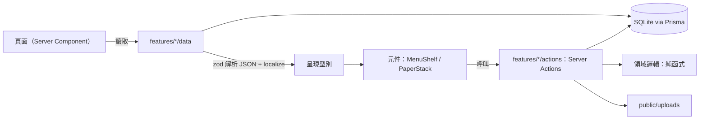
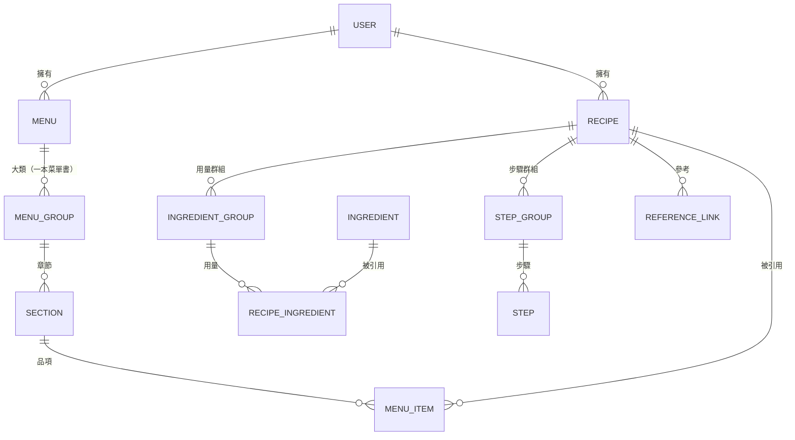

# 架構

> 技術選擇與資料模型已定案（見 [ADR 索引](adr/README.md)）。

## 系統總覽

Next.js 16（App Router）+ TypeScript + Tailwind CSS v4 的單人本機網站。

| 層       | 選擇                                                   | 決策                                       |
| -------- | ------------------------------------------------------ | ------------------------------------------ |
| 資料     | Prisma 7 + SQLite；頁面以 `data/` 模組讀取，寫入走 Server Actions | [ADR-0001](adr/0001-prisma-with-sqlite.md) |
| 內容語言 | 需要翻譯的文字存成欄位層 JSON `{ en, zh }`               | [ADR-0013](adr/0013-localized-json-fields.md) |
| 介面語言 | cookie 記住目前語言，頁面依它讀資料；介面文字放 TS 字典，server 訊息以 key 傳遞 | [ADR-0028](adr/0028-locale-cookie.md)、[ADR-0029](adr/0029-ui-dictionary.md) |
| 使用者   | 一個預設使用者，使用者資料帶 `userId`；食材目錄共用       | [ADR-0014](adr/0014-default-user.md) |
| 圖片     | 本機 `public/uploads/`，DB 只存路徑                    | [ADR-0002](adr/0002-local-image-storage.md) |
| UI 元件  | shadcn（Base UI）+ Tailwind design tokens              | [ADR-0003](adr/0003-shadcn-base-ui.md)     |
| 首頁版面 | 菜單書架（`MenuShelf`），每本書是一組紙張堆疊（`PaperStack`）；動畫用 `motion`，總覽滾輪用 `wheel-gestures` | [ADR-0007](adr/0007-paper-stack-layout.md) |
| 配色     | 菜單主題（`MenuTheme`）TS 設定檔，以 CSS 變數套用到每本書 | [ADR-0008](adr/0008-menu-theme-colors.md) |
| 食譜匯入 | Claude API（Haiku 5.5）經 Route Handler 產生草稿；網址由伺服器抓取；食材由程式比對目錄，目錄不送給 LLM | [ADR-0022](adr/0022-llm-import-with-haiku.md)、[ADR-0023](adr/0023-url-import-extraction.md)、[ADR-0026](adr/0026-ingredient-matching-pipeline.md) |

- 首頁每次請求都讀資料庫（`<Suspense>` 內先 `connection()`），build 時不連資料庫；寫入後 Server Action 以 `refresh()` 重新整理畫面。
- 同一個 `<Suspense>` 內讀 cookie 取得[介面語言](features/bilingual-ui.md)，傳給資料存取函式與 `LocaleProvider`；root layout 不讀 cookie，維持靜態。
- 編輯在書上的[編輯卡](features/editor.md)進行：卡片以 Server Action 讀取雙語草稿，Save 時把草稿交給同一份 zod schema 驗證後在一個 transaction 內寫入；目前的卡記在網址 `?edit=`（[ADR-0017](adr/0017-editor-cards-with-push-state.md)）。
- [食譜匯入](features/recipe-import.md)是唯一的 Route Handler（`POST /api/recipe-import`）：要收大檔案，也要能中止 LLM 請求。它只回傳草稿，寫入仍走 `createDish`。外部服務見[資料來源](data-sources.md)。
- 元件只依賴 `src/features/*/types.ts` 的呈現型別，不 import Prisma 型別。

## 核心概念與關係

- 同一道食譜可以出現在多本菜單。
- 菜單品項（MenuItem）有自己的顯示名稱與描述，不影響底層食譜；價格不存，載入頁面時由食譜用量與食材價格算出每份成本（[ADR-0032](adr/0032-dish-cost-computed.md)）。
- 用量的單位換算：單位清單標記重量、體積或計數，食材自己記計數單位重量與密度；資料庫保留原文單位（[ADR-0031](adr/0031-unit-conversion-data.md)）。
- 食材（Ingredient）是獨立的目錄資料，用量與品項描述以 id 引用（[ADR-0011](adr/0011-ingredient-catalog.md)）；品項描述片段的引用存在 JSON 內，沒有外鍵。
- 步驟文字分段，片段以用量行 id 引用同一道食譜的用量（[ADR-0015](adr/0015-step-text-references-lines.md)）。
- 菜單主題 id 與用量單位存字串，合法值由程式碼清單決定（[ADR-0016](adr/0016-code-lists-as-strings.md)）。
- 欄位定義以 `prisma/schema.prisma` 為準。

## 設計原則

1. **資料與呈現分離**：資料模型與商業邏輯不依賴 UI；元件只負責呈現。
2. **特色在 UI 與動畫，但不犧牲操作**：獨特的呈現與動畫是網站特色，資料與呈現分離，必要時另提供精簡的快速檢視（清單或搜尋）。
3. **主題化**：頁面尺寸、顏色、字型用 design tokens 管理，為之後的 PDF 輸出與多種菜單主題預留空間。
4. **單一設定檔**：可調參數集中管理，文件只引用路徑。

## 已知風險

- 動畫與特殊版面可能拖累編輯、搜尋與手機操作 → 由原則 1、2 處理：資料與呈現分離，並保留 QuickView 當後路。

## 目錄結構

| 路徑                     | 內容                                   |
| ------------------------ | -------------------------------------- |
| `src/app/`               | 路由（App Router）；`api/recipe-import/` 為匯入的 Route Handler |
| `src/components/ui/`     | shadcn 元件                            |
| `src/components/`        | 專案共用元件；`locale-switch.tsx` 為頁首的語言切換 |
| `src/features/<feature>/` | 功能模組（components / hooks / lib / data / actions）；目前有 `menu`、`recipe`、`ingredient`、`paper-stack`、`menu-theme`、`menu-shelf`、`editor`、`recipe-import`（`server/` 為呼叫 LLM 與抓網頁的 server-only 程式） |
| `src/features/<feature>/data/` | 讀資料庫的 server-only 函式，回傳呈現型別 |
| `src/features/<feature>/actions/` | Server Actions（寫入） |
| `public/textures/`       | 紙張、卡紙材質等鋪滿表面的圖片         |
| `public/stationery/`     | 疊在紙上的文具：長尾夾、迴紋針（[ADR-0020](adr/0020-stationery-assets.md)） |
| `public/ingredients/`    | 食材目錄的照片（進 git）               |
| `src/lib/`               | 共用函式庫；`db.ts` 為 Prisma 單例、`current-user.ts` 為目前使用者 |
| `src/lib/i18n/`          | 雙語內容的型別與 `localize()`；介面語言的 cookie、`LocaleProvider` 與字典 `messages/` |
| `src/generated/prisma/`  | Prisma 產出（gitignored）              |
| `prisma/`                | schema、migrations、`seed.ts` 與範例資料 `seed-data.json` |
| `docs/`                  | 專案文件（MkDocs）                     |
| `.claude/`               | Claude 規則與指令                      |
| `.github/`               | CI workflow 與 issue 模板              |
| `scripts/`               | 工具腳本                               |

## 待決定

- 圖片上傳細節（#59）

各項待規劃時建立計畫，見 [計畫索引](plans/README.md)。
