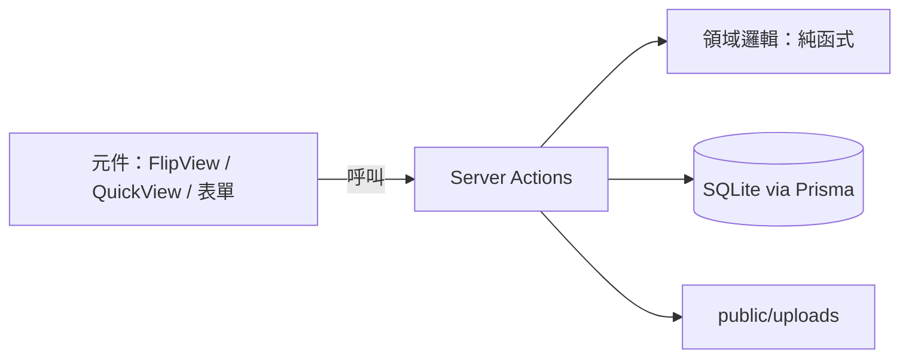
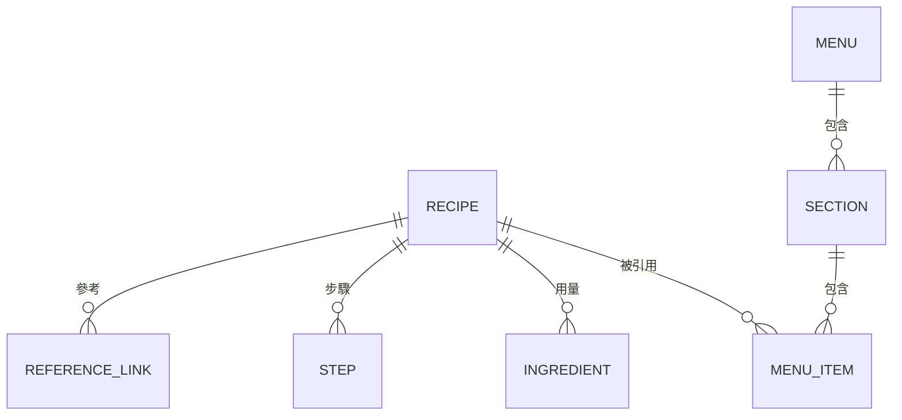

# 架構

> 技術選擇已定案（見 [ADR 索引](adr/README.md)）；資料模型細節待後續計畫決定後補全。

## 系統總覽

Next.js 16（App Router）+ TypeScript + Tailwind CSS v4 的單人本機網站。

| 層       | 選擇                                                   | 決策                                       |
| -------- | ------------------------------------------------------ | ------------------------------------------ |
| 資料     | Prisma 7 + SQLite，資料存取走 Server Actions           | [ADR-0001](adr/0001-prisma-with-sqlite.md) |
| 圖片     | 本機 `public/uploads/`，DB 只存路徑                    | [ADR-0002](adr/0002-local-image-storage.md) |
| UI 元件  | shadcn（Base UI）+ Tailwind design tokens              | [ADR-0003](adr/0003-shadcn-base-ui.md)     |
| 翻頁     | `motion` + CSS 3D transform 自製                       | [ADR-0004](adr/0004-custom-page-flip.md)   |
| 色彩模式 | `next-themes`（light / dark 切換，初次造訪跟隨 system） | —                                          |

## 核心概念與關係

- 同一道食譜可以出現在多本菜單。
- 菜單品項（MenuItem）有自己的顯示名稱、描述、價格，不影響底層食譜。
- 此關係為初始假設，資料模型計畫確認後以 ADR 記錄。

## 設計原則

1. **資料與呈現分離**：資料模型與商業邏輯不依賴 UI；元件只負責呈現。
2. **翻頁只是菜單檢視的一種皮**：另保留不翻頁的快速檢視（清單或搜尋），避免翻頁效果拖累編輯、搜尋與手機操作。
3. **主題化**：頁面尺寸、顏色、字型用 design tokens 管理，為之後的 PDF 輸出與多種菜單主題預留空間。
4. **單一設定檔**：可調參數集中管理，文件只引用路徑。

## 已知風險

- 翻頁的擬真效果可能拖累編輯、搜尋與手機操作 → 由原則 1、2 處理：資料與呈現分離，並保留 QuickView 當後路。

## 目錄結構

| 路徑                     | 內容                                   |
| ------------------------ | -------------------------------------- |
| `src/app/`               | 路由（App Router）                     |
| `src/components/ui/`     | shadcn 元件                            |
| `src/components/`        | 專案共用元件（如色彩模式切換）         |
| `src/features/<feature>/` | 功能模組（components / hooks / lib / actions） |
| `src/lib/`               | 共用函式庫；`db.ts` 為 Prisma 單例     |
| `src/generated/prisma/`  | Prisma 產出（gitignored）              |
| `prisma/`                | schema 與 migrations                   |
| `docs/`                  | 專案文件（MkDocs）                     |
| `.claude/`               | Claude 規則與指令                      |
| `.github/`               | CI workflow 與 issue 模板              |
| `scripts/`               | 工具腳本                               |

## 待決定

- 資料模型欄位與關係、圖片上傳細節
- 翻頁元件的互動細節

各項待規劃時建立計畫，見 [計畫索引](plans/README.md)。
