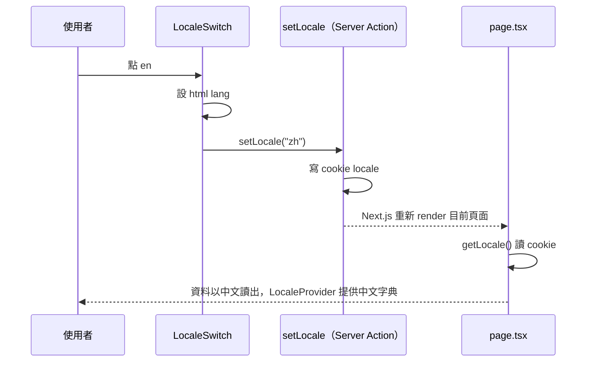

# 雙語介面

## 一句話

頁首 menu 按鈕旁的切換按鈕把整個網站在英文與中文之間切換：介面文字、菜單與食譜內容、單位寫法都跟著換，選擇記在 cookie。

## 流程

## 規則 / 狀態

| 項目 | 規則 |
| ---- | ---- |
| 切換按鈕 | 頁首 menu 按鈕左邊，只顯示目前語言（`en` / `zh`），點一下切成另一種；編輯卡開著時頁首不可操作 |
| 版頭 | 站名 epifolio 與 menu 按鈕在中文介面也維持英文 |
| 記住 | cookie `locale`，一年；沒有或無效的值是英文；重新整理、關掉再開都保持（[ADR-0028](../adr/0028-locale-cookie.md)） |
| 切換後 | 書名、品項、食譜、食材卡片以新語言重新讀出；目前的書、紙張、份數、勾選不重設 |
| 內容缺語言 | 欄位只有一種語言時顯示那一種（`localize()`，[ADR-0013](../adr/0013-localized-json-fields.md)） |
| 介面文字 | 全部來自字典 `src/lib/i18n/messages/`，`en.ts` 定義結構、`zh.ts` 必須有相同的 key（[ADR-0029](../adr/0029-ui-dictionary.md)） |
| 錯誤訊息 | Server Action、zod schema、匯入 Route Handler 回傳訊息 key（`ErrorMessage`），畫面依目前語言顯示；Anthropic API 自己的錯誤說明原樣附上 |
| 程式碼清單 | 菜單主題名稱放在 `menu-themes.ts`、單位寫法放在 `units.ts`，各自帶兩種語言（[ADR-0016](../adr/0016-code-lists-as-strings.md)） |
| 編輯卡 | 打開時編輯語言預設為網站語言；卡上的 `EN \| ZH` 只切換正在編輯的文字（見[編輯卡](editor.md)） |
| `<html lang>` | 預設 `en`，head 的內嵌 script 依 cookie 改成 `zh-Hant`，切換時直接改 |
| 字型 | 中文接在拉丁字型之後：標題 Noto Serif TC、內文 Noto Sans TC；英文外觀不變（[ADR-0030](../adr/0030-chinese-fonts.md)） |

## 參數

語言清單與預設語言見 `src/lib/i18n/localized.ts`；cookie 名稱與各語言的 `lang` 值見 `src/lib/i18n/locale-cookie.ts`；cookie 期限見 `src/lib/i18n/set-locale.ts`。（已確認）

## 已知限制

- 頁面 `<title>` 與 description 不隨語言改變（root layout 維持靜態），#97。

## 相關連結

[ADR-0028](../adr/0028-locale-cookie.md)、[ADR-0029](../adr/0029-ui-dictionary.md)、[ADR-0030](../adr/0030-chinese-fonts.md)、[PLAN-009](../plans/PLAN-009-bilingual-ui.md)、#53
