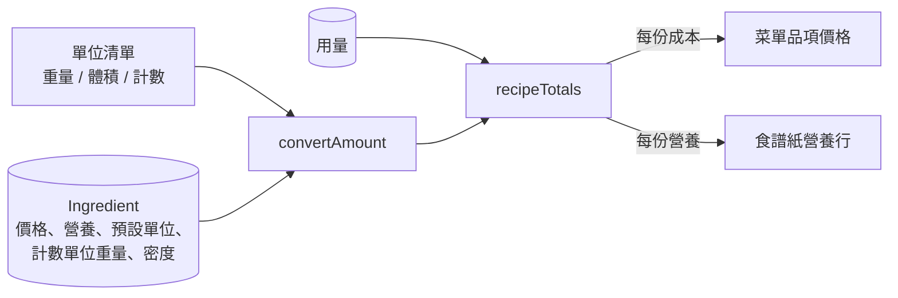

# 料理成本與營養

## 一句話

用食譜的用量和食材的價格、營養、換算資料，算出每份的食材成本與營養：菜單品項的價格就是每份成本，食譜紙在材料下方顯示每份營養。

## 流程

每次載入頁面時在 `page.tsx` 計算，不存資料庫（[ADR-0032](../adr/0032-dish-cost-computed.md)）。食材在卡片背面存檔後，頁面重新整理，價格與營養跟著變。

## 規則 / 狀態

| 項目 | 規則 |
| ---- | ---- |
| 單位種類 | 單位清單的每個單位是重量（固定幾 g）、體積（固定幾 ml）或計數（瓣、片、個、球、把、根，每個食材自己記幾 g）；pinch、dash 當成很小的體積 |
| 換算 | 同單位直接用；同為重量或同為體積用固定係數；其他經由公克：體積要食材的密度，計數要食材的該單位重量 |
| 計入的用量 | 連到食材、而且有數量的用量；適量與沒連到食材的用量不計，也不算不完整 |
| 範圍 | 取中間值（80–100 g 算 90 g） |
| 沒寫單位 | 用食材的預設單位；沒有預設單位時當成「個」 |
| 成本 | 換算成價格的單位後按比例計算（例如價格 25 / 100 g，用量 20 g 就是 5） |
| 營養 | 換算成公克後依每 100 g 的值計算；四項營養任一項缺值，該行不計 |
| 每份 | 除以食譜的份數；食譜沒寫份數時是整份，食譜紙標示「整份」 |
| 不完整 | 有計入的用量算不出來（缺價格、密度或計數單位重量）：菜單價格後加 `+`（滑鼠停留有說明），營養行加 `*` 並附說明 |
| 算不出來 | 沒有任何一行算得出來：菜單不顯示價格，食譜紙不顯示營養行 |
| 份數控制 | 營養行固定是每份，不隨食譜紙的份數控制改變 |
| 原文單位 | 資料庫永遠存食譜原本的數量與單位，換算只在計算時進行（[ADR-0031](../adr/0031-unit-conversion-data.md)） |

## 參數

- 各單位的種類與係數、沒寫單位時的預設：見 `src/features/recipe/units.ts`（`unitMeasures`、`bareCountUnit`）。
- 各食材的預設單位、計數單位重量、密度：存在資料庫，在食材卡片背面編輯；匯入的新食材由 LLM 估計，現有食材由 Claude 一次估計寫入（都標記為估計值）。

## 已知限制

- 對上既有食材時，匯入不會補上它缺少的換算資料，這些用量會讓結果不完整（#111）。

## 相關連結

- ADR：[ADR-0031](../adr/0031-unit-conversion-data.md)、[ADR-0032](../adr/0032-dish-cost-computed.md)
- 計畫：[PLAN-008](../plans/PLAN-008-ingredient-editing.md)
- 功能：[食材卡片](ingredient-card.md)
- Issue：#42、#110
