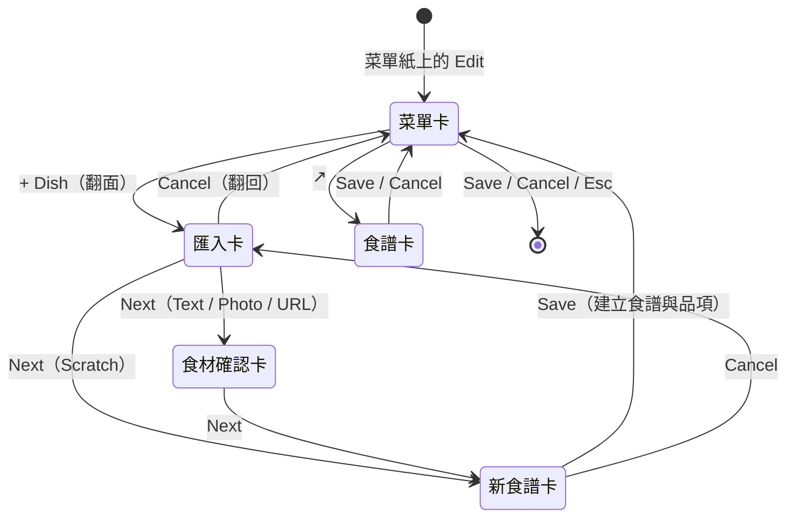
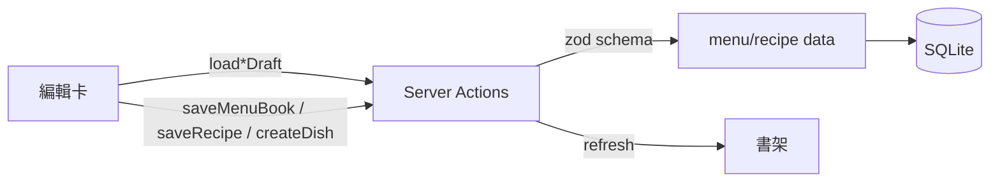

# 編輯卡

## 一句話

在書上打開的卡片：菜單編輯卡改書名、章節與品項，翻面成匯入卡新增品項，再到食譜編輯卡改食譜；所有修改先是草稿，按 Save 才寫入。

## 流程

- 目前的卡記在網址 `?edit=`，每次換卡以 `pushState` 加一筆紀錄；上一頁回到前一張卡，重新整理會回到同一張卡（[ADR-0017](../adr/0017-editor-cards-with-push-state.md)）。
- 菜單卡的草稿與匯入卡填的菜名由 `EditorLayer` 保管，翻面、去食譜卡再回來都還在；關閉編輯器就丟棄。
- 本頁的按鈕與欄位名稱用英文介面的寫法；中文介面依字典顯示（見[雙語介面](bilingual-ui.md)）。
- 表單、Server Action 共用 `src/features/menu/schema.ts` 與 `src/features/recipe/schema.ts`；[食譜匯入](recipe-import.md)的結果也通過同一份 schema。

## 規則 / 狀態

| 項目 | 規則 |
| ---- | ---- |
| 入口 | 閱讀模式下，置中那本菜單紙右上角的編輯按鈕打開菜單卡；食譜紙右上角的編輯按鈕直接打開該食譜的食譜卡（存檔或取消後關卡）；總覽不顯示 |
| 開卡時 | 書留在原位、不可操作，上面蓋一層遮罩；卡片從下方冒出，關閉時往下消失 |
| 編輯語言 | 每張卡右上角 `EN \| ZH`，只切換正在編輯的文字，打開時預設為[介面語言](bilingual-ui.md)；至少要有一種語言，缺的語言畫面上退回另一種（[ADR-0013](../adr/0013-localized-json-fields.md)） |
| 直接編輯 | 點文字就變成輸入框；Enter 或離開欄位結束，Esc 還原成開始編輯時的內容（不會關卡） |
| 菜單卡 | 左上角是書名；章節名選填；品項名下方一行描述，片段以 ` · ` 分隔 |
| 新增 | `+ Section` 新增空章節並直接編輯；`+ Dish` 翻面到匯入卡，尚未存檔的新章節不能加品項 |
| 移除 | 滑過或用鍵盤移到該列時，左側與第一行對齊處出現 `−`；品項只移出菜單、食譜留在資料庫（[ADR-0019](../adr/0019-remove-from-menu-keeps-recipe.md)）。移除章節或用量、步驟的 group 時內容保留：併到上一組的最後，沒有上一組就併到下一組的最前面；只剩一組時只清掉名稱 |
| 拖曳 | 沒有把手，按住移動幾個像素才算拖曳；品項可跨章節、章節整組移動、兩者不能互換；正在輸入的列不能拖；Esc 取消拖曳但不關卡（[ADR-0018](../adr/0018-dnd-kit-sortable.md)） |
| 匯入卡 | 左上角 Import from 與右上角語言切換同一列；Scratch（預設）填菜名（必填）與描述；Text、Photo、URL 交給 LLM 讀取，之後經食材確認卡到食譜卡，見[食譜匯入](recipe-import.md) |
| 食譜卡 | 標題是食譜名；`Ingredients` 右側是份數；用量行四欄 Qty / Unit / Ingredient / Note，照輸入的大小寫顯示；步驟兩欄 Highlight（選填）/ Instruction；`References` 是網址清單，與 group 同一層。編輯中的列只顯示各欄位的底線 |
| 空白列 | 用量行或步驟什麼都沒填就結束編輯時自動移除 |
| Instruction 換行 | Enter 結束編輯，Shift+Enter 換行；食譜紙照樣換行 |
| Qty | 接受 `2`、`1.5`、`1/2`、`1 1/2`、`80-100`，可留空；格式錯誤時 Save 被擋下並提示 |
| 內容 ↔ 小標 | 在用量行或步驟的第一個欄位（或整列被選取時）按 Shift+Tab 變成小標，後面的列歸到它底下；在小標上按 Tab 變回內容，併入上一組；步驟的小標文字放進 Highlight。用量行變成小標時數量、單位、備註捨棄。其他欄位的 Tab 照常移到下一欄 |
| 食材連結 | 用量與描述片段的文字沒改就保留原本的食材連結；改過或新增的，整段或第一個逗號前的文字等於食材名稱或別名（忽略大小寫、複數）才連上 |
| 存檔 | 菜單卡 Save 一次寫入並關卡；食譜卡 Save 後回到菜單卡（從菜單卡來時）或關卡；新食譜 Save 同時建立食譜與品項（放在該章節最後），回到菜單卡並加進草稿 |
| 失敗 | Save 失敗時保留草稿並顯示 toast（指出第一個問題，例如步驟缺 Instruction）；網址指到不存在或不屬於目前使用者的資料時忽略 |
| 關卡 | 草稿在卡片收完後才丟棄，關卡時維持原本內容往下收 |
| 背面 | 菜單卡與匯入卡是同一張卡的兩面，以垂直中線翻面；另一面的內容左右鏡像、淡淡透出；迴紋針在背面出現在左上角 |
| 減少動態效果 | 卡片直接出現、消失與翻面 |

## 參數

- 動畫（開關、換卡、翻面、拖曳門檻）：見 `src/features/editor/editor-motion.ts`。（待校準）
- 卡片底色、尺寸、打孔、票券缺角、遮罩、背面透明度、迴紋針位置、捲軸：見 `src/app/globals.css` 的 Editor cards 區塊。（待校準）
- 份數範圍：見 `src/features/recipe/scaling.ts`；單位清單：見 `src/features/recipe/units.ts`。

## 已知限制

- 沒有防呆：刪除不確認，未存檔就關閉或重新整理會失去草稿（#56）。
- 移出菜單的食譜在畫面上看不到，要等食譜庫（#57）。
- 新章節要先存檔才能加品項（#71）。
- 描述片段只在整段或第一個逗號前的文字完全等於食材名稱或別名時才連上，「Golden garlic」這類寫法連不到 Garlic；別名目前只會在匯入的食材確認卡選擇連結時加上（#108）。
- 食譜的時間、筆記、步驟分鐘數不能編輯（#58）；不能新增書（#60）。
- 窄螢幕仍用桌面版面（#10）。

## 相關連結

- ADR：[ADR-0017](../adr/0017-editor-cards-with-push-state.md)、[ADR-0018](../adr/0018-dnd-kit-sortable.md)、[ADR-0019](../adr/0019-remove-from-menu-keeps-recipe.md)、[ADR-0020](../adr/0020-stationery-assets.md)
- 計畫：[PLAN-006](../plans/PLAN-006-menu-recipe-editor.md)
- Issue：#61
