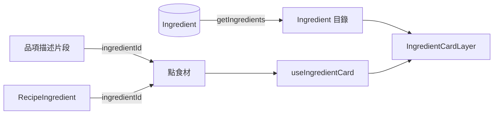
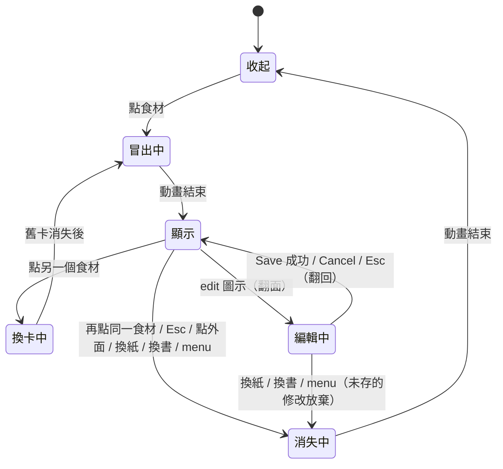

# 食材卡片

## 一句話

點菜單品項描述或食譜用量中的食材（`Ingredient`），食材卡片（`IngredientCard`）從螢幕下方冒出，顯示照片、價格與營養；點 edit 圖示翻面編輯。卡片跟著紙張捲動，關閉時往下消失。

## 流程

## 規則 / 狀態

| 項目 | 規則 |
| ---- | ---- |
| 可點的食材 | 有 `ingredientId` 的描述片段與用量名稱；沒有的外觀不變、不能點。點描述只開卡片，不換紙；點菜名照舊換到食譜紙 |
| 用量那一行 | 名稱開卡片；框框與其他文字切換勾選 |
| 位置 | 依開啟當下的螢幕決定：垂直置中，與螢幕右緣的距離由 token 決定，不依紙張位置 |
| 捲動 | 卡片在紙張的捲動內容裡，與紙張完全同步，可能捲出畫面，不會自動關閉；在卡片上滾動會捲動紙張 |
| 動畫 | 從螢幕下方帶傾斜往上冒出、擺正；關閉時往下沉出畫面 |
| 動畫中 | 忽略點食材；關閉（Esc、點外面、換紙、換書）一律生效 |
| 編輯中 | 忽略點食材與點外面；Esc 等於 Cancel；換紙、換書、menu 照常關閉卡片 |
| 減少動態效果 | 直接出現與消失 |
| 正面 | 照片（4:3）在上；名稱與價格（`$金額 / 數量 單位`，數量為 1 時省略）、營養表（每 100 g）對齊卡片下緣，有沒有照片都一樣；缺的欄位不顯示；右上角 edit 圖示（無底色） |
| 大小 | 所有卡片同高，以有照片、營養齊全的卡片為準；背面同樣大小 |
| 背面 | 沒有小標：英文名、中文名上下排，下面接 `$` 價格 / 數量 / 單位；營養（每 100 g）、預設單位、別名（逗號分隔）對齊下緣，左標籤右欄位；Save / Cancel。密度與計數單位重量不在卡片上，存檔時原樣保留（之後在食材列表頁編輯，#109） |
| 驗證 | 名稱至少一種語言；價格有填就要選單位，數量留空視為 1；數字不能為負，數量、重量、密度要大於 0；同一計數單位只列一次；錯誤一次顯示一則，欄位加粗底線 |
| 存檔 | 名稱與其他食材的名稱或別名相同、新加的別名是其他食材的名稱或別名時拒絕；手動改過的營養或換算值不再標記為估計；存檔後依賴這個食材的價格與營養立即更新（[料理成本與營養](dish-totals.md)） |
| 外觀 | 底色與文字色固定，不隨菜單主題變動；疊上卡紙材質；長尾夾夾在卡片上緣，正面在左、背面在右 |

## 參數

- 動畫時長、緩動曲線、位移距離、傾斜角度：見 `src/features/ingredient/card-motion.ts`。（待校準）
- 卡片寬度、高度、內距、與螢幕右緣的距離、顏色、材質透明度、長尾夾大小與位置：見 `src/app/globals.css` 的 Ingredient card 區塊。（待校準）
- 翻面的時長與緩動：沿用編輯卡的 `src/features/editor/editor-motion.ts`（`flip`）。
- 背面欄位轉換與驗證：見 `src/features/ingredient/lib/ingredient-form.ts`；可選單位：`src/features/recipe/units.ts`。
- 材質：`public/textures/card-stock.webp`；長尾夾：`public/textures/binder-clip.webp`；食材照片：`public/ingredients/<ingredientId>.webp`（4:3、960×720）。

## 已知限制

- 只能從菜單或食譜點開食材卡片；沒被任何地方用到的食材無法編輯（#109）。
- 不能換照片（#59）。

## 相關連結

- ADR：[ADR-0011](../adr/0011-ingredient-catalog.md)、[ADR-0012](../adr/0012-ingredient-card-layer.md)、[ADR-0031](../adr/0031-unit-conversion-data.md)
- 計畫：[PLAN-004](../plans/PLAN-004-recipe-layout-and-ingredient-card.md)、[PLAN-008](../plans/PLAN-008-ingredient-editing.md)
- Issue：#33、#42
