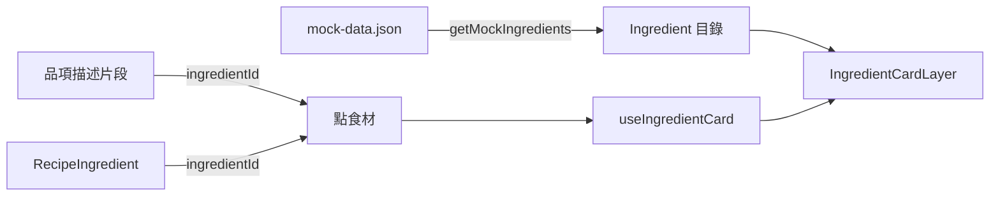
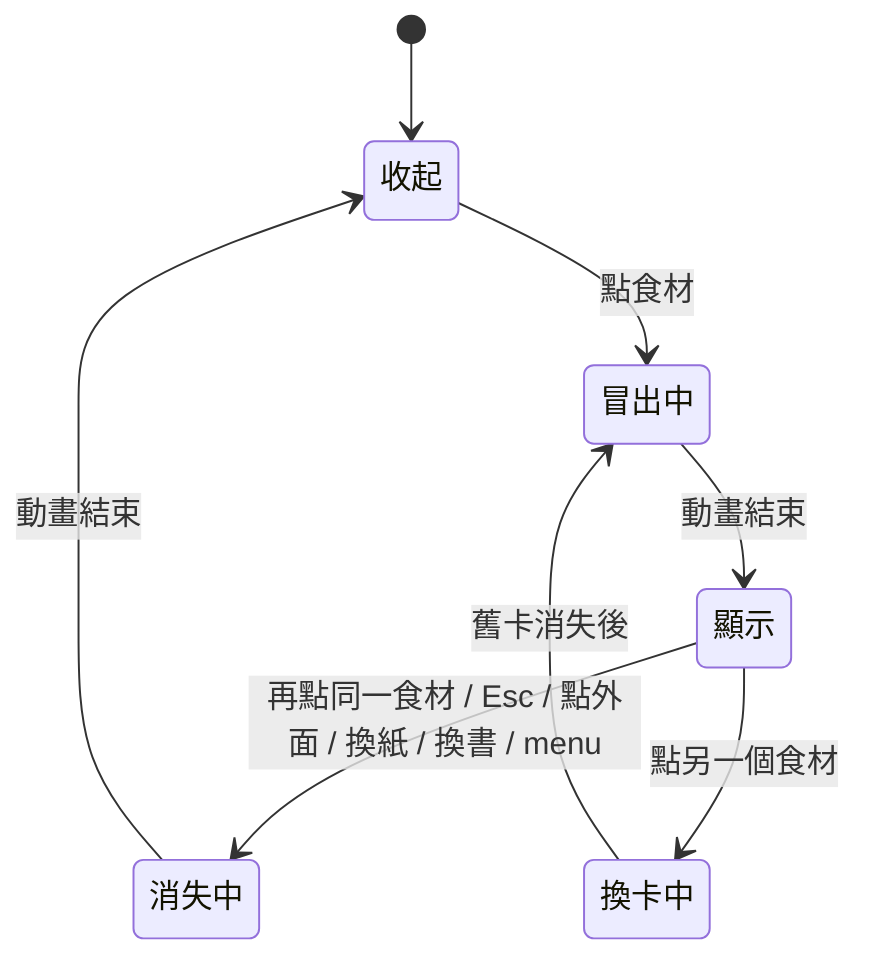

# 食材卡片

## 一句話

點菜單品項描述或食譜用量中的食材（`Ingredient`），食材卡片（`IngredientCard`）從螢幕下方冒出，顯示照片、價格與營養；之後跟著紙張捲動，關閉時往下消失。

## 流程

## 規則 / 狀態

| 項目 | 規則 |
| ---- | ---- |
| 可點的食材 | 有 `ingredientId` 的描述片段與用量名稱；沒有的外觀不變、不能點。點描述只開卡片，不換紙；點菜名照舊換到食譜紙 |
| 用量那一行 | 名稱開卡片；框框與其他文字切換勾選 |
| 位置 | 依開啟當下的螢幕決定：垂直置中，與螢幕右緣的距離由 token 決定，不依紙張位置 |
| 捲動 | 開啟後跟著該書的紙張捲動，可能捲出畫面，不會自動關閉；在卡片上滾動會捲動紙張 |
| 動畫 | 從螢幕下方帶傾斜往上冒出、擺正；關閉時往下沉出畫面 |
| 動畫中 | 忽略點食材；關閉（Esc、點外面、換紙、換書）一律生效 |
| 減少動態效果 | 直接出現與消失 |
| 內容 | 照片（4:3）、名稱與價格（`$金額 / 計價單位`）、營養表（每 100 g）；缺的欄位不顯示 |
| 外觀 | 底色與文字色固定，不隨菜單主題變動；疊上卡紙材質 |

## 參數

- 動畫時長、緩動曲線、位移距離、傾斜角度：見 `src/features/ingredient/card-motion.ts`。（待校準）
- 卡片寬度、內距、與螢幕右緣的距離、顏色、材質透明度：見 `src/app/globals.css` 的 Ingredient card 區塊。（待校準）
- 材質：`public/textures/card-stock.webp`；食材照片：`public/ingredients/<ingredientId>.webp`（4:3、960×720）。

## 已知限制

- 價格只有單一值，沒有購買紀錄與平均價；營養與價格尚未用來計算料理成本（#42）。
- 食材資料是 mock，沒有編輯介面。

## 相關連結

- ADR：[ADR-0011](../adr/0011-ingredient-catalog.md)、[ADR-0012](../adr/0012-ingredient-card-layer.md)
- 計畫：[PLAN-004](../plans/PLAN-004-recipe-layout-and-ingredient-card.md)
- Issue：#33、#42
