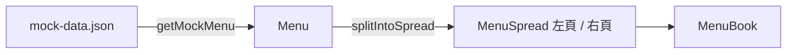

# 菜單書

## 一句話

首頁就是一本攤開的菜單（`Menu`），左右兩頁呈現各章節（`Section`）的品項（`MenuItem`）。

## 流程

- 元件只依賴 `src/features/menu/types.ts` 的呈現型別；資料來源（目前為 mock，之後為資料庫）只需換掉 `getMockMenu()`。
- mock 資料的 dish 同時含食譜與品項欄位，目前只讀取菜名、描述、價格。

## 規則 / 狀態

| 項目 | 規則 |
| ---- | ---- |
| 章節順序 | 依 mock 資料的 category `order` 排序；沒有品項的章節不顯示 |
| 左右分頁 | 章節不拆開；依序放左頁，直到左頁品項數超過全部的一半（無條件進位）為止，其餘放右頁 |
| 頁首 | 左頁為網站標題，右頁為色彩模式（`ColorMode`）切換 |
| 摺痕 | 右頁左側的實線，使用 `border` 色 |
| 品項 | 菜名（`font-heading`）、價格（純數字）、描述（無描述則不顯示） |
| 內容超過頁高 | 該頁內捲動 |

## 參數

- 配色：見 `src/app/globals.css` 的 `:root` 與 `.dark`。（已確認）
- 字體：見 `src/lib/fonts.ts`，管理方式見 [ADR-0006](../adr/0006-role-based-fonts-with-next-font.md)。（已確認）

## 已知限制

- 窄螢幕仍固定左右兩頁並排（#10）。
- 尚無翻頁、編輯，品項無法點擊進入食譜。

## 相關連結

- ADR：[ADR-0006](../adr/0006-role-based-fonts-with-next-font.md)
- 計畫：[PLAN-001](../plans/PLAN-001-menu-book-layout.md)
- Issue：#5
