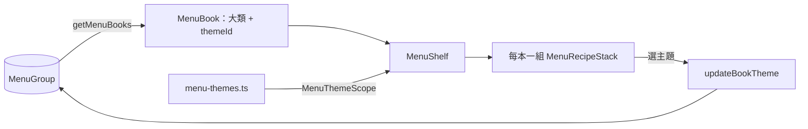
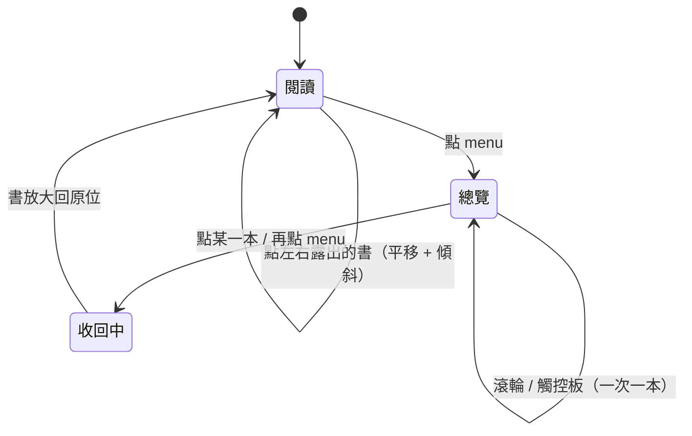

# 菜單書架

## 一句話

首頁有多本菜單書（`MenuBook`），每本是一個大類加一組菜單主題（`MenuTheme`），主題可從菜單紙上換；目前這本在畫面正中間，左右露出上一本與下一本，右上角的 menu 按鈕把所有書縮小排成一列（總覽），它左邊是[語言切換](bilingual-ui.md)。

## 流程

- `MenuShelf` 負責畫面，並記住每本書哪張紙在上、食譜紙顯示哪道菜；階段、目前位置、動畫在 `useMenuShelf`；位置規則是 `shelf-layout.ts` 的純函式。
- 書以「虛擬位置」排列，像無限輪播：書數 ≥ 3 時位置 `k` 顯示第 `k mod 書數` 本，同一本可以同時出現在多個位置（例如 3 本時排成 `1 2 [3] 1 2`）。移動只改變哪個位置在中間，沒有書會從一端跳到另一端。
- 每本書的內容沿用[紙張堆疊](paper-stack.md)，元件只用語意 token，配色由外層的 `MenuThemeScope` 決定（[ADR-0008](../adr/0008-menu-theme-colors.md)）。

## 規則 / 狀態

| 項目 | 規則 |
| ---- | ---- |
| 閱讀模式位置 | 目前這本置中；書數 ≥ 3 時無限循環，左側是上一本（第一本的上一本是最後一本），右側是下一本，兩側各多準備一本在畫面外；書數 = 2 時不循環；書數 = 1 時兩側沒有書 |
| 兩側的書 | 兩側露出相同寬度的菜單紙（左側另外露出食譜紙打孔區）；不能捲動、內容不可聚焦；整張紙是「Open 大類名」按鈕。畫面外的書整本 `inert` |
| 切換 | 點兩側的書：整排平移一本，每本移動距離相同、間距不變，以頂端為軸傾斜、下緣領先，停下擺正 |
| 捲動中切換 | 從畫面上捲到的位置開始動畫，同時平順捲回頂端；進總覽時相同 |
| 書的狀態 | 每本書記住哪張紙在上與食譜紙顯示的菜；切換書、進出總覽都保留。同一本在循環中的每個位置狀態相同 |
| 紙張高度 | 兩種模式共用同一組最小高度 token（菜單紙、食譜紙各一），內容較多時更長；總覽只縮放，不改變高度與比例；超出畫面的部分不能捲動查看 |
| 總覽 | 所有書以頂端左角縮小排成一列，第一格對齊頁首內距；在頁首區下方垂直置中，畫面不夠高時改為與頁首區保持最小間距；原本中間那本在左數第二格；壓在菜單紙下的食譜紙空白（保留高度），食譜在上的書照常顯示食譜 |
| 總覽滾輪 | 所有書都放得下時不能移動。否則一次手勢（含觸控板慣性）只移動一本；垂直滾動與水平滑動都可以；書數 ≥ 3 無限循環；書數 = 2 時到頭就停 |
| 離開總覽 | 點某一本：放大回閱讀模式，該本置中。再點 menu：回到進入總覽前的那本（取總覽中最靠左的那一個位置）。原本不在總覽列中的書從它在列中應有的位置（畫面外）滑入 |
| 動畫中 | 忽略點擊與滾輪 |
| 減少動態效果 | 直接切換位置，不播放動畫 |
| 視窗縮放 | 總覽時重新量測並排列 |
| 編輯 | 閱讀模式下菜單紙右上角的編輯按鈕打開[菜單編輯卡](editor.md)，食譜紙右上角的編輯按鈕打開該食譜的食譜編輯卡；編輯卡開著時書架不可操作 |
| 換主題 | 閱讀模式下菜單紙右上角（編輯按鈕右邊）的調色盤按鈕開啟主題清單，列出 `menu-themes.ts` 的每一組（名稱與色塊）並勾選目前的；只有置中那本可操作，總覽不顯示。選了立即換色並存進資料庫，選單關閉；存檔失敗時換回原主題並顯示 toast |
| 刪除 | 菜單紙右上角最右邊的垃圾桶：確認後刪除整本書（大類、章節、品項），食譜留在資料庫（[ADR-0019](../adr/0019-remove-from-menu-keeps-recipe.md)）；刪除後原位置換成下一本，失敗時顯示 toast |
| 主題不存在 | 資料庫裡的主題 id 已不在 `menu-themes.ts` 時以第一組主題顯示，不改寫資料庫 |
| 沒有書 | 資料庫沒有菜單（例如還沒跑 seed）時只顯示網站標題 |

## 參數

- 書寬、兩側露出寬度（`--shelf-peek`，隨視窗寬度縮放，書距由它推算）、菜單紙與食譜紙的最小高度、總覽縮放比例、總覽與頁首區的最小間距、總覽左側內距與書距、頁首標題與 menu、語言按鈕字級（`--text-masthead`、`--text-masthead-nav`）：見 `src/app/globals.css`。（待校準）
- 平移、傾斜角度、總覽縮放、滾輪門檻與時長：見 `src/features/menu-shelf/shelf-motion.ts`。（待校準）
- 配色：見 `src/features/menu-theme/menu-themes.ts`。（待校準）
- 滾輪手勢辨識用 `wheel-gestures`，見 [ADR-0009](../adr/0009-shelf-wheel-snap.md)。

## 已知限制

- 窄螢幕仍使用桌面版面（#10）。
- 只有觸控板與滑鼠滾輪，沒有觸控滑動。
- 還不能新增菜單或大類（#51）；主題只能從現有幾組挑選，不能自訂配色。

## 相關連結

- ADR：[ADR-0008](../adr/0008-menu-theme-colors.md)、[ADR-0009](../adr/0009-shelf-wheel-snap.md)
- 計畫：[PLAN-003](../plans/PLAN-003-menu-books.md)、[PLAN-005](../plans/PLAN-005-database.md)
- Issue：#23
