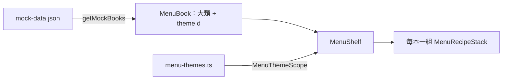
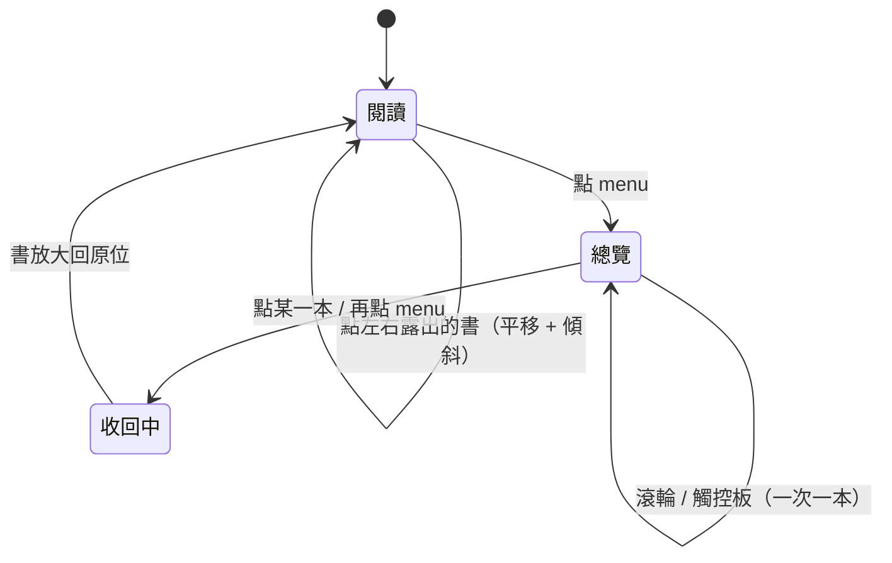

# 菜單書架

## 一句話

首頁有多本菜單書（`MenuBook`），每本是一個大類加一組菜單主題（`MenuTheme`）；目前這本在畫面正中間，左右露出上一本與下一本，右上角的 menu 按鈕把所有書縮小排成一列（總覽）。

## 流程

- `MenuShelf` 負責畫面；階段、目前這本、動畫在 `useMenuShelf`；位置規則是 `shelf-layout.ts` 的純函式。
- 每本書的內容沿用[紙張堆疊](paper-stack.md)，元件只用語意 token，配色由外層的 `MenuThemeScope` 決定（[ADR-0008](../adr/0008-menu-theme-colors.md)）。

## 規則 / 狀態

| 項目 | 規則 |
| ---- | ---- |
| 閱讀模式位置 | 目前這本置中；書數 ≥ 3 時循環，左側是上一本（第一本的上一本是最後一本），右側是下一本；書數 = 2 時不循環；書數 = 1 時兩側沒有書 |
| 兩側的書 | 被畫面邊緣裁切，不能捲動、內容不可聚焦；整張紙是「Open 大類名」按鈕。畫面外的書整本 `inert` |
| 切換 | 點兩側的書：整排平移一本，每本以頂端為軸傾斜、下緣領先，停下擺正；因循環換到另一側的書往畫面外繼續移動，不橫越畫面 |
| 關上的書 | 離開中間或進入總覽時重新掛載：回到頂端、菜單紙在上 |
| 總覽 | 所有書以頂端左角縮小排成一列，第一格對齊頁首內距；原本中間那本在左數第二格；每本兩張紙固定高度，食譜紙空白 |
| 總覽滾輪 | 一次手勢（含觸控板慣性）只移動一本；垂直滾動與水平滑動都可以；書數 ≥ 3 循環，循環的書從一側離開、另一側進來；書數 = 2 時到頭就停 |
| 離開總覽 | 點某一本：放大回閱讀模式，該本置中。再點 menu：回到進入總覽前的那本。位置跨過循環的書在途中淡出再淡入 |
| 動畫中 | 忽略點擊與滾輪 |
| 減少動態效果 | 直接切換位置，不播放動畫 |
| 視窗縮放 | 總覽時重新量測並排列 |

## 參數

- 書寬、書距、總覽縮放比例、總覽左側內距與書距、固定紙張高度：見 `src/app/globals.css`。（待校準）
- 平移、傾斜角度、總覽縮放、滾輪門檻與時長：見 `src/features/menu-shelf/shelf-motion.ts`。（待校準）
- 配色：見 `src/features/menu-theme/menu-themes.ts`。（待校準）
- 滾輪手勢辨識用 `wheel-gestures`，試用中（#30）。

## 已知限制

- 窄螢幕仍使用桌面版面（#10）。
- 只有觸控板與滑鼠滾輪，沒有觸控滑動。
- 書與配色是 mock 資料，還不能新增菜單或自訂配色。

## 相關連結

- ADR：[ADR-0008](../adr/0008-menu-theme-colors.md)
- 計畫：[PLAN-003](../plans/PLAN-003-menu-books.md)
- Issue：#23
