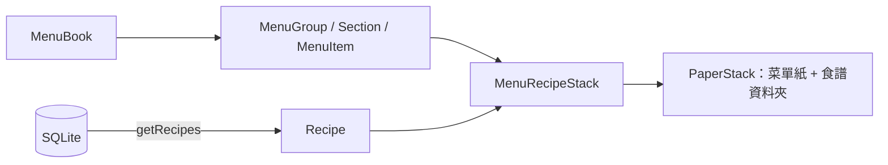
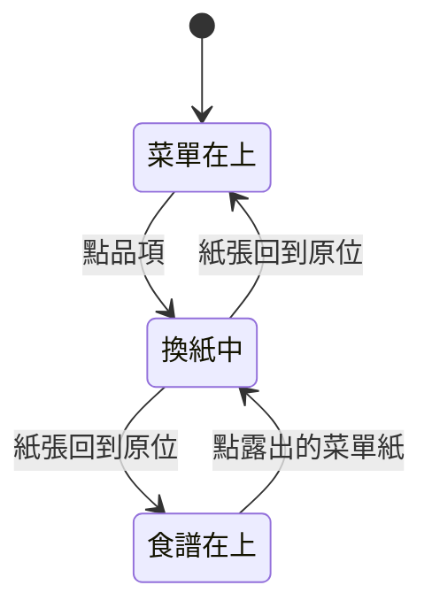

# 紙張堆疊

## 一句話

每本菜單書（見[菜單書架](menu-shelf.md)）是疊在深色背景上的菜單紙與[食譜資料夾](recipe-folder.md)：顯示該書大類（`MenuGroup`）的菜單紙在上，食譜（`Recipe`）的資料夾在下；點品項（`MenuItem`）時兩者換位，改由資料夾在上。

## 流程

- 元件只依賴 `MenuItem`、`Recipe` 等呈現型別，由 `src/features/menu/data/` 與 `src/features/recipe/data/` 從資料庫讀出；品項以 `recipeId` 引用食譜。
- `PaperStack` 不認識菜單或食譜，只管捲動區、固定圖層、疊放順序與換紙動畫；內容由 `MenuRecipeStack` 傳入。菜單紙在捲動區，資料夾在填滿書本、不捲動的固定圖層（[ADR-0033](../adr/0033-recipe-folder-pull-out.md)）。

## 規則 / 狀態

| 項目 | 規則 |
| ---- | ---- |
| 版面 | 整頁不捲動，每本書的菜單紙在自己的整個畫面高度捲動區裡（只有中間那本能捲動）；一開始菜單紙從頁首區下方開始，往上捲時蓋過頁首。菜單紙在畫面水平置中；資料夾的位置見[食譜資料夾](recipe-folder.md) |
| 捲動 | 菜單在上層時捲動菜單紙；資料夾在上層時捲動區鎖住，滾動改為抽做法紙 |
| 菜單紙高度 | 依內容決定，最少是最小高度 token |
| 紙張外觀 | 菜單紙用 `background` / `foreground`，數值來自所在書的菜單主題；每種紙有自己的材質，以 `overlay` 疊在底色上、文字下方，文字維持純色 |
| 打孔 | 打孔的紙（做法紙）右側一排圓洞，是真正透明的洞，看得到下層內容 |
| 捲動區留白 | 捲動區左右比書本多留一段空間（不碰到鄰書露出的部分），只垂直捲動，換紙時傾斜的紙張與食材卡片不會在書本邊緣被切掉 |
| 頁首 | 由書架提供，固定不捲動、沒有自己的底色，在紙張下層；網站標題在左、menu 按鈕在右 |
| 菜單紙 | 顯示所在菜單書的大類；最上方是大類名稱（大字、大寫、結尾加句點、`primary`，略超出紙張左上角、超出部分被裁掉），右上角是編輯、主題、刪除按鈕（閱讀模式置中那本才有，見[菜單書架](menu-shelf.md)）；其餘內容有紙張內距；章節小標（選填；襯線、粗體、大寫、結尾加句點、`primary`）；品項顯示菜名（無襯線、大寫、一般字重與字距、`foreground`）、價格（靠右，每份食材成本，算不完整時後加 `+`，見[料理成本與營養](dish-totals.md)）、描述（小字、細體，無則不顯示）；點菜名換到食譜資料夾，點描述中的食材開[食材卡片](ingredient-card.md) |
| 字級 | 依用途分為 caption、body、title、subheading、heading、headline、display 七級，元件不使用 `text-sm` 等預設字級 |
| 食譜 | 內容與操作見[食譜資料夾](recipe-folder.md)；尚未選品項時顯示菜單上第一個品項的食譜 |
| 份數換算 | 範圍見設定檔；所有有數量的用量依「目前份數 ÷ 食譜份數」換算，範圍值兩端都換算，常見分數顯示為分數 |
| 備料進度 | 份數、勾選（以用量行 id 記錄）與資料夾的開關以食譜為單位存在書架層，換食譜、換書後仍在，重新整理即重設 |
| 捲軸 | 可以捲動，但不顯示捲軸 |
| 上層紙 | 由外部（書架）決定並保存，`usePaperStack` 只負責換紙動畫 |
| 換紙 | 菜單紙與資料夾帶旋轉往下離開畫面，在看不到的地方換疊放順序、菜單紙捲回頂端、做法紙收回，再往上回到原位擺正；位置不變，只有疊放順序改變 |
| 換回 | 點下層露出的部分會換到上層；菜單沒有任何品項時，點資料夾沒反應 |
| 換紙中 | 忽略所有換紙要求 |
| 減少動態效果 | 系統設定開啟時直接換紙，不播放動畫 |
| 下層 | 內容不可聚焦（`inert`），露出的部分由「Show menu / Show recipe」按鈕覆蓋 |
| 未打開 | 書架兩側或總覽中的堆疊（`inactive`）：不捲動、內容 `inert`，菜單紙與資料夾都是打開該書的按鈕；紙張可超出捲動區下緣，上緣仍被裁切 |

## 參數

- 配色：見 `src/features/menu-theme/menu-themes.ts`；背景色、菜單紙尺寸與內距、書寬（含資料夾突出的部分）、材質透明度：見 `src/app/globals.css`。（待校準）
- 字級（大小、行高、字距）：見 `src/app/globals.css` 的 type scale `@theme`。（待校準）
- 換紙動畫的時長、緩動曲線、旋轉角度、兩張紙的間隔：見 `src/features/paper-stack/swap-motion.ts`。（待校準）
- 份數範圍、分數、取整單位：見 `src/features/recipe/scaling.ts`。（待校準）
- 紙張材質：菜單紙 `public/textures/fiber-paper.webp`；資料夾的材質見[食譜資料夾](recipe-folder.md)。
- 字體：見 `src/lib/fonts.ts`，管理方式見 [ADR-0006](../adr/0006-role-based-fonts-with-next-font.md)。（已確認）

## 已知限制

- 窄螢幕仍使用桌面版面（#10）。
- 食譜沒有網址；瀏覽器上一頁不會回到菜單。
- 份數換算只乘倍數，不換單位。

## 相關連結

- ADR：[ADR-0007](../adr/0007-paper-stack-layout.md)、[ADR-0011](../adr/0011-ingredient-catalog.md)、[ADR-0033](../adr/0033-recipe-folder-pull-out.md)
- 計畫：[PLAN-002](../plans/PLAN-002-paper-stack.md)（前身：[PLAN-001](../plans/PLAN-001-menu-book-layout.md)）、[PLAN-004](../plans/PLAN-004-recipe-layout-and-ingredient-card.md)、[PLAN-011](../plans/PLAN-011-recipe-folder.md)
- Issue：#13、#33
