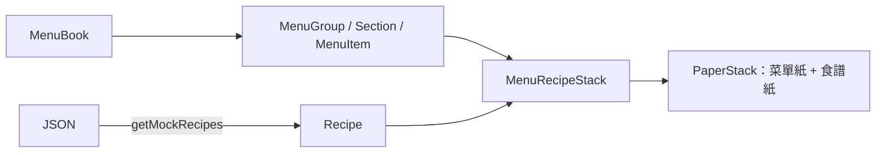
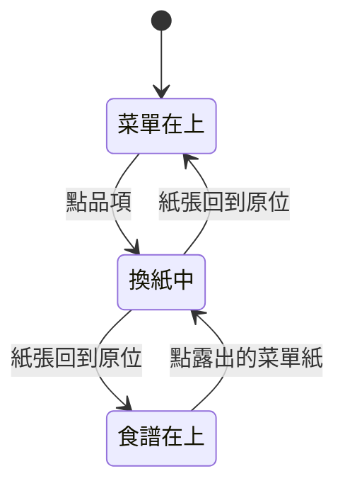

# 紙張堆疊

## 一句話

每本菜單書（見[菜單書架](menu-shelf.md)）是兩張疊在深色背景上的紙：顯示該書大類（`MenuGroup`）的菜單紙在上，打孔的食譜紙（`Recipe`）在下；點品項（`MenuItem`）時兩張紙換位，改由食譜紙在上。

## 流程

- 元件只依賴 `MenuItem`、`Recipe` 等呈現型別；mock 資料的 dish 同時含品項與食譜欄位，由兩個轉換函式分別讀取，品項以 `recipeId` 引用食譜。
- `PaperStack` 不認識菜單或食譜，只管兩張紙的位置、疊放順序與換紙動畫；內容由 `MenuRecipeStack` 傳入。

## 規則 / 狀態

| 項目 | 規則 |
| ---- | ---- |
| 版面 | 整頁不捲動，每本書的紙張在自己的整個畫面高度捲動區裡（只有中間那本能捲動）；一開始紙張從頁首區下方開始，往上捲時紙張蓋過頁首。菜單紙較窄、在畫面水平置中，食譜紙依菜單紙定位；食譜紙往下錯開，左緣縮在菜單紙內 1.5 個紙張內距，右緣超出菜單紙打孔區加 1.5 個紙張內距。兩張紙一起捲動 |
| 紙張高度 | 每張紙依自己的內容決定高度，最少是各自的最小高度 token（菜單紙比食譜紙高），兩張紙底部不對齊 |
| 紙張外觀 | 菜單紙用 `background` / `foreground`，食譜紙用 `primary` / `primary-foreground`，數值來自所在書的菜單主題；兩張紙各有自己的材質，透明度隨菜單主題，以 `overlay` 疊在底色上、文字下方，文字維持純色 |
| 打孔 | 食譜紙右側一排圓洞，是真正透明的洞，看得到下層內容 |
| 捲動區留白 | 捲動區左右比書本多留一段空間（不碰到鄰書露出的部分），只垂直捲動，換紙時傾斜的紙張與食材卡片不會在書本邊緣被切掉 |
| 頁首 | 由書架提供，固定不捲動、沒有自己的底色，在紙張下層；網站標題在左、menu 按鈕在右 |
| 菜單紙 | 顯示所在菜單書的大類；最上方是大類名稱（大字、大寫、結尾加句點、`primary`，略超出紙張左上角、超出部分被裁掉），右上角是廚師名稱（無襯線、大寫、內文字級、`primary`，上方與右方留白都是紙張內距）；其餘內容有紙張內距；章節小標（選填；襯線、粗體、大寫、結尾加句點、`primary`）；品項顯示菜名（無襯線、大寫、一般字重與字距、`foreground`）、價格（靠右）、描述（小字、細體，無則不顯示）；點菜名換到食譜紙，點描述中的食材開[食材卡片](ingredient-card.md) |
| 字級 | 依用途分為 caption、body、title、heading、headline、display 六級，元件不使用 `text-sm` 等預設字級 |
| 食譜紙 | 標題 → 上下有分隔線的 `INGREDIENTS` 列（右側份數 `− n +`）→ 用量群組兩欄 → `INSTRUCTIONS` 列 → 步驟群組（編號跨群組連續）。群組小標選填。不顯示時間與筆記。尚未選品項時顯示菜單上第一個品項的食譜 |
| 份數 | `+` / `−` 加減 1，範圍見設定檔；所有有數量的用量依「目前份數 ÷ 食譜份數」換算，範圍值兩端都換算，常見分數顯示為分數。食譜沒有份數時不顯示 |
| 勾選 | 點用量的框框或文字切換勾選，勾選後劃掉變淡；份數與勾選以食譜為單位存在書架層，換食譜、換書後仍在，重新整理即重設 |
| 捲軸 | 可以捲動，但不顯示捲軸 |
| 上層紙 | 由外部（書架）決定並保存，`usePaperStack` 只負責換紙動畫 |
| 換紙 | 兩張紙帶旋轉往下離開捲動區，在看不到的地方換疊放順序並捲回頂端，再往上回到原位擺正；位置不變，只有疊放順序改變 |
| 換回 | 點下層紙露出的部分會換到上層；菜單沒有任何品項時，點食譜紙沒反應 |
| 換紙中 | 忽略所有換紙要求 |
| 減少動態效果 | 系統設定開啟時直接換紙，不播放動畫 |
| 下層紙 | 內容不可聚焦（`inert`），整張由「Show menu / Show recipe」按鈕覆蓋 |
| 未打開 | 書架兩側或總覽中的堆疊（`inactive`）：不捲動、內容 `inert`，兩張紙都是打開該書的按鈕；紙張可超出捲動區下緣，上緣仍被裁切 |

## 參數

- 配色：見 `src/features/menu-theme/menu-themes.ts`；背景色、紙張尺寸、內距與錯開距離、打孔尺寸與間距、材質透明度：見 `src/app/globals.css`。（待校準）
- 字級（大小、行高、字距）：見 `src/app/globals.css` 的 type scale `@theme`。（待校準）
- 換紙動畫的時長、緩動曲線、旋轉角度、兩張紙的間隔：見 `src/features/paper-stack/swap-motion.ts`。（待校準）
- 份數範圍、分數、取整單位：見 `src/features/recipe/scaling.ts`。（待校準）
- 紙張材質：菜單紙 `public/textures/fiber-paper.webp`、食譜紙 `public/textures/paper.webp`。
- 廚師名稱：目前沒有使用者功能，全站固定，見 `src/lib/site-config.ts`。
- 字體：見 `src/lib/fonts.ts`，管理方式見 [ADR-0006](../adr/0006-role-based-fonts-with-next-font.md)。（已確認）

## 已知限制

- 窄螢幕仍使用桌面版面（#10）。
- 食譜沒有網址；瀏覽器上一頁不會回到菜單。
- 份數換算只乘倍數，不換單位。

## 相關連結

- ADR：[ADR-0007](../adr/0007-paper-stack-layout.md)、[ADR-0011](../adr/0011-ingredient-catalog.md)
- 計畫：[PLAN-002](../plans/PLAN-002-paper-stack.md)（前身：[PLAN-001](../plans/PLAN-001-menu-book-layout.md)）、[PLAN-004](../plans/PLAN-004-recipe-layout-and-ingredient-card.md)
- Issue：#13、#33
