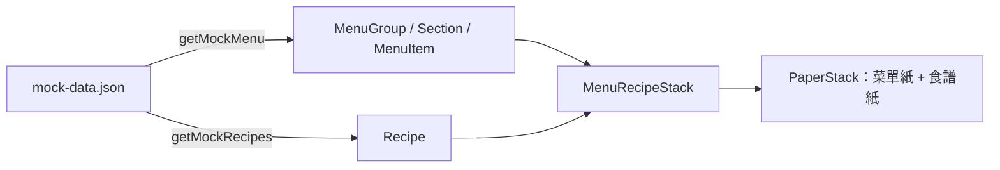
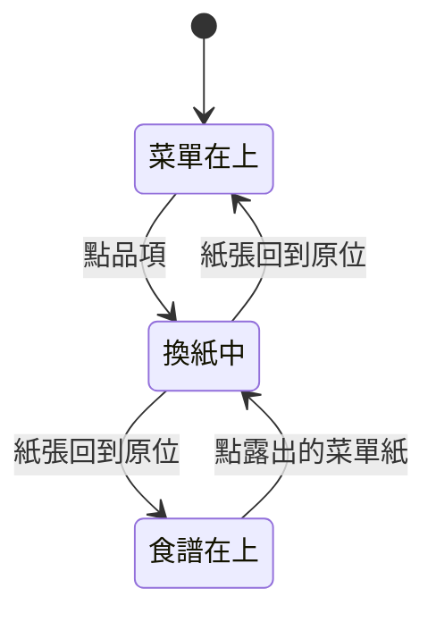

# 紙張堆疊

## 一句話

首頁是兩張疊在深色背景上的紙：顯示一個大類（`MenuGroup`）的菜單紙在上，打孔的食譜紙（`Recipe`）在下；點品項（`MenuItem`）時兩張紙換位，改由食譜紙在上。

## 流程

- 元件只依賴 `MenuItem`、`Recipe` 等呈現型別；mock 資料的 dish 同時含品項與食譜欄位，由兩個轉換函式分別讀取，品項以 `recipeId` 引用食譜。
- `PaperStack` 不認識菜單或食譜，只管兩張紙的位置、疊放順序與換紙動畫；內容由 `MenuRecipeStack` 傳入。

## 規則 / 狀態

| 項目 | 規則 |
| ---- | ---- |
| 版面 | 整頁不捲動：上方是固定的頁首區，下方是紙張的捲動區。菜單紙在原點，食譜紙往右下錯開；兩張紙在同一個捲動區裡一起捲動，往上捲時在頁首區下緣被切齊 |
| 紙張高度 | 每張紙依自己的內容決定高度，最少是捲動區的高度，兩張紙底部不對齊 |
| 紙張外觀 | 菜單紙用 `background` / `foreground`，食譜紙用 `primary` / `primary-foreground`；材質以 `overlay` 疊在底色上、文字下方，文字維持純色 |
| 打孔 | 食譜紙右側一排圓洞，是真正透明的洞，看得到下層內容 |
| 頁首 | 固定不捲動；網站標題在左、色彩模式切換在右，都在紙張外 |
| 菜單紙 | 只顯示第一個有品項的大類（切換方式見 #21）；最上方是大類名稱（大字、小寫、`primary`），章節小標（襯線、粗體、大寫、結尾加句點、`primary`）；品項顯示菜名（無襯線、大寫、`foreground`）、價格（靠右）、描述（小字、細體，無則不顯示） |
| 字級 | 依用途分為 caption、body、title、heading、headline、display 六級，元件不使用 `text-sm` 等預設字級 |
| 食譜紙 | 純文字顯示份量、時間、用量、步驟、筆記；尚未選品項時是空白 |
| 換紙 | 兩張紙帶旋轉往下離開捲動區，在看不到的地方換疊放順序並捲回頂端，再往上回到原位擺正；位置不變，只有疊放順序改變 |
| 換回 | 點下層紙露出的部分會換到上層；食譜紙在還沒選品項時點了沒反應 |
| 換紙中 | 忽略所有換紙要求 |
| 減少動態效果 | 系統設定開啟時直接換紙，不播放動畫 |
| 下層紙 | 內容不可聚焦（`inert`），整張由「Show menu / Show recipe」按鈕覆蓋 |

## 參數

- 配色、背景色、紙張尺寸與錯開距離、打孔尺寸與間距、材質透明度：見 `src/app/globals.css`。（待校準）
- 字級（大小、行高、字距）：見 `src/app/globals.css` 的 type scale `@theme`。（待校準）
- 換紙動畫的時長、緩動曲線、旋轉角度、兩張紙的間隔：見 `src/features/paper-stack/swap-motion.ts`。（待校準）
- 紙張材質：`public/textures/paper.webp`。
- 字體：見 `src/lib/fonts.ts`，管理方式見 [ADR-0006](../adr/0006-role-based-fonts-with-next-font.md)。（已確認）

## 已知限制

- 窄螢幕仍使用桌面版面（#10）。
- 只顯示第一個大類，無法切換到其他大類（#21）。
- 食譜只有純文字，沒有正式排版，也沒有網址；瀏覽器上一頁不會回到菜單。

## 相關連結

- ADR：[ADR-0007](../adr/0007-paper-stack-layout.md)
- 計畫：[PLAN-002](../plans/PLAN-002-paper-stack.md)（前身：[PLAN-001](../plans/PLAN-001-menu-book-layout.md)）
- Issue：#13
