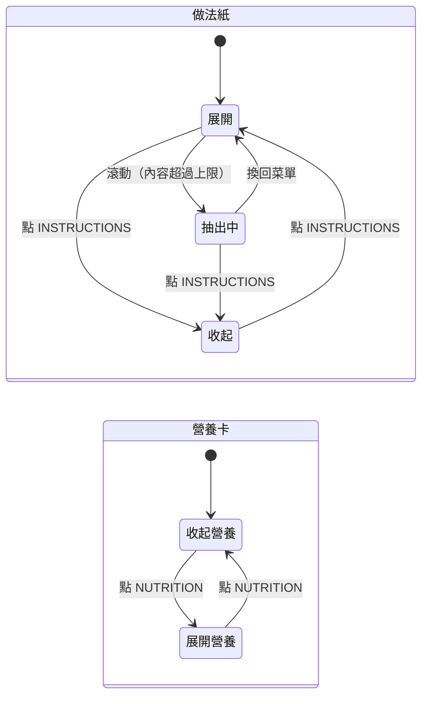

# 食譜資料夾

## 一句話

食譜（`Recipe`）以資料夾（`RecipeFolder`）呈現在[紙張堆疊](paper-stack.md)的固定圖層：前層資料夾放名稱、份數與用量，做法紙（`InstructionSheet`）與營養卡（`NutritionCard`）從資料夾裡抽出；做法紙太長時，滾動把它繼續往上抽。

## 流程

由後往前疊放：做法紙 → 後層資料夾（NUTRITION tab）→ 營養卡 → 前層資料夾（INSTRUCTIONS tab）。

## 規則 / 狀態

| 項目 | 規則 |
| ---- | ---- |
| 位置 | 資料夾以下緣對齊畫面底部（留一段間距），高度固定，每道食譜都一樣；右緣對齊書本右緣，左緣縮在菜單紙內 |
| 前層資料夾 | 底色 `primary`、文字 `primary-foreground`，材質同菜單紙，透明度隨菜單主題；左側 INSTRUCTIONS tab |
| 後層資料夾 | `primary` 的深色版（由主題推算，主題可覆寫，[ADR-0035](../adr/0035-derived-deep-primary.md)）；上緣比前層略高，INSTRUCTIONS 右邊接 NUTRITION tab |
| tab | 點一下切換對應紙張的展開與收起，兩張各自獨立；展開時 tab 文字粗斜體。預設做法紙展開、營養卡收起 |
| 開關狀態 | 跟份數、勾選一樣以食譜為單位記在書架層（`RecipeProgress.panels`），換書、換食譜後保留，重新整理即重設 |
| 動畫 | 紙張從資料夾滑出、滑回；減少動態效果時直接切換 |
| 做法紙 | 每個主題都相同的紙色與文字色，材質是 `paper.webp`；右側打孔，有自己的孔徑與間距 token |
| 露出高度 | min(內容高度, 上限)；上限是資料夾上緣到菜單紙上緣再往下一段的距離，視窗太矮時至少露出最小值 |
| 抽出 | 食譜在上層、做法紙展開、內容超過上限時，滾輪、觸控拖曳、方向鍵、PageUp / PageDown / 空白鍵、Home / End 把紙往上抽，最多到內容全部露出；抽的同時資料夾往下壓（營養卡跟著），壓到約一半後只剩紙往上抽；菜單紙不動（[ADR-0033](../adr/0033-recipe-folder-pull-out.md)）。焦點在按鈕或輸入欄時鍵盤不抽紙 |
| 收回 | 換回菜單時抽出量歸零；收起做法紙時連同抽出的部分一起滑回；資料夾被壓下時，點資料夾任何地方（勾選框與 tab 除外）彈回原位，這一下不觸發其他操作 |
| 做法紙內容 | `INSTRUCTIONS` 標題列；步驟群組小標 `[ LABEL ]`；每步一行粗體重點（結尾加句點），下一行縮排顯示內文；有時間的步驟在重點那行右側顯示計時圖示與時間；編號跨群組連續；有筆記時最後顯示 `[ NOTES ]` 與編號清單 |
| 前層內容 | 食譜名稱（襯線粗體）、右上角編輯按鈕（閱讀模式置中那本才有，打開[食譜編輯卡](editor.md)）、`INGREDIENTS` 列（右側翻頁與份數控制，下方虛線）、用量群組（小標 `[ LABEL ]`） |
| 用量欄位 | 固定三欄，各欄高度平均；群組接在上一組後面（小標前留一段間距），可跨欄，小標不會單獨留在欄底，一行用量不拆開；放不下時分頁，資料夾高度不變；只有一頁時不顯示翻頁；份數或語言改變時重新計算 |
| 份數 | `+` / `−` 加減 1，所有有數量的用量依「目前份數 ÷ 食譜份數」換算，規則見[紙張堆疊](paper-stack.md)；食譜沒有份數時不顯示 |
| 勾選 | 點用量的框框或文字切換勾選，勾選後劃掉變淡；點有連結的食材名稱開[食材卡片](ingredient-card.md) |
| 營養卡 | 黑白迴紋針夾在上緣，微傾斜；圓環圖中間是卡路里（不完整時數字後加 `*`，說明在 tooltip 與螢幕閱讀器文字），三段是蛋白質、碳水、脂肪，顏色是文字色的三種透明度，長度依熱量佔比（4 / 4 / 9 kcal/g）；卡上不標示每份或整份；下方三行標克數；沒有營養資料時只顯示一句說明。計算見[料理成本與營養](dish-totals.md) |
| 菜單在上層 | 資料夾在後面不動、內容不可聚焦，露出的紙張與資料夾都是「Show recipe」按鈕；尚未選品項、菜單沒有品項時點了沒反應 |
| 未打開的書 | 書架兩側與總覽中照目前狀態顯示，點了打開該書，不能抽紙；總覽時資料夾依縮小前的畫面高度定位 |

## 參數

- 資料夾、做法紙、營養卡的尺寸、位置、tab、打孔、顏色、材質透明度、迴紋針：見 `src/app/globals.css` 的 Recipe folder 區塊。（待校準）
- 後層資料夾的推算方式：見 `src/app/globals.css` 的 `[data-menu-theme]` 區塊；主題覆寫見 `src/features/menu-theme/menu-themes.ts`。（待校準）
- 預設展開的紙張、滑出動畫、抽紙的 spring、滾輪與按鍵的移動量：見 `src/features/recipe/folder-motion.ts`。（待校準）
- 材質：資料夾與營養卡 `public/textures/fiber-paper.webp`、做法紙 `public/textures/paper.webp`；迴紋針 `public/stationery/paper-clip-mono.webp`（與編輯卡的 `paper-clip-color.webp` 同尺寸）。（已確認）

## 已知限制

- 窄螢幕仍使用桌面版面（#10）。
- 視窗很矮時做法紙露出很少，主要靠抽出閱讀（#124）。
- 營養卡打開時會蓋住做法紙右側的文字（#125）。
- 步驟時間與筆記還不能在食譜編輯卡修改（#58）。
- 較長的食材名稱會整段換到數量的下一行（#126）。

## 相關連結

- ADR：[ADR-0033](../adr/0033-recipe-folder-pull-out.md)、[ADR-0034](../adr/0034-step-minutes-and-notes-from-llm.md)、[ADR-0035](../adr/0035-derived-deep-primary.md)
- 計畫：[PLAN-011](../plans/PLAN-011-recipe-folder.md)
- Issue：#114
