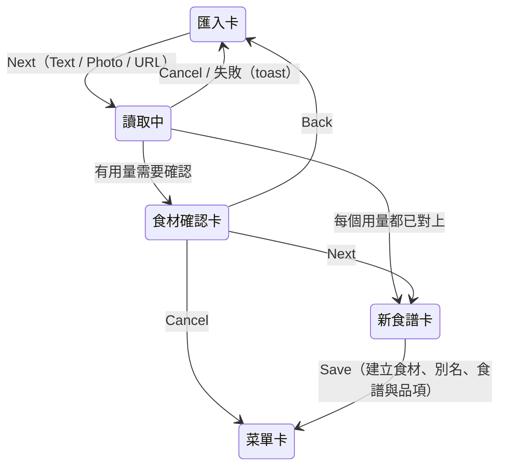
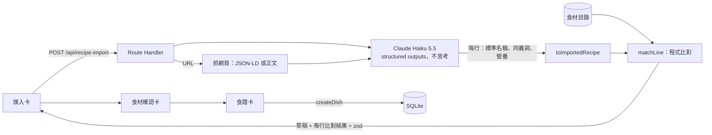

# 食譜匯入

## 一句話

在匯入卡貼文字、放照片 / PDF 或貼網址，由 Claude 整理成雙語的品項與食譜草稿，程式把每行用量比對到食材目錄，在食材確認卡確認對應，再到食譜卡檢查、按 Save 寫入。

## 流程

- LLM 只產生草稿，不碰資料庫；所有寫入都經由食譜卡的 Save（[ADR-0022](../adr/0022-llm-import-with-haiku.md)）。
- 每次匯入只呼叫一次 LLM，而且不送食材目錄；食材對應由程式比對（[ADR-0026](../adr/0026-ingredient-matching-pipeline.md)）。
- 模型不思考：開啟思考時模型偶爾把大部分輸出花在思考、提早結束答案而漏掉步驟（ADR-0022 的 2026-10-14 補充）。
- 匯入結果與食材的決定由 `EditorLayer` 保管，和 Scratch 的菜名一樣，關閉編輯器或存檔後就丟棄；原文與上傳的檔案不保留。

## 規則 / 狀態

| 項目 | 規則 |
| ---- | ---- |
| 來源 | `Scratch`（手填）、`Text`（貼上）、`Photo`（JPEG / PNG / WebP / PDF，可多個、可拖放）、`URL` |
| 檔案上限 | 照片與 PDF 各有單檔上限，另有總大小與檔案數上限（API 單次請求 32 MB，檔案以 base64 送出會變大約三分之一）；匯入卡當場提示，伺服器也再檢查一次 |
| 讀取中 | Next 變成 `Spinner` 與 `Reading…`，輸入鎖住；Cancel 或離開卡片會中止請求 |
| 成功 | 菜名與描述填回 Scratch 欄位並切到 Scratch；之後在 Scratch 按 Next 仍沿用這次匯入的結果 |
| 網址 | 只抓公開的 `http(s)` 網址，每次轉址都檢查；先讀頁面的 JSON-LD `Recipe`，沒有就抽正文；網址加進 References（[ADR-0023](../adr/0023-url-import-extraction.md)） |
| 整理內容 | 一次產生 en / zh；修順句子；每一步都要輸出；敘述拆成步驟、必要時分組並加 Highlight；原文沒寫的量留空、不猜；只在步驟出現、清單沒有的食材補成一行用量；原文的提示放在最後一步並標 Tip；名稱只寫食材，切法與補充放備註；「A 或 B」只取 A、備註寫「或 B」 |
| 單位 | 只用單位清單（[ADR-0024](../adr/0024-more-units.md)）；清單外的寫法數量照填、不帶單位；沒有數量的用量在食譜紙顯示 To taste |
| 步驟引用用量 | LLM 標出每一步提到的用量行，存檔後成為步驟片段的 `lineId`（[ADR-0015](../adr/0015-step-text-references-lines.md)）；在食譜卡改過的步驟退回純文字 |
| 食材對應 | LLM 給每行標準名稱、中英同義詞與營養估計（或標為非食材）；程式正規化後（大小寫、全半形、標點、英文複數）比對目錄的名稱與別名；原文寫法優先於 LLM 給的名稱；粒度：價格或營養明顯不同才算不同食材 |
| 食材確認卡 | 食材小卡的卡紙與長尾夾；標題下顯示 N MATCHED · N NOT MATCHED；名稱一律中英並列（EN \| ZH），沒有語言切換。非食材的行不顯示、自動不連結；已對上的行收在最下方，可展開 |
| 每一列 | 原文寫法（中英）與 `Create new` / `Link to` 單選。預設：有相符食材的選 Link to 並預選最可能的；沒有的選 Create new |
| Link to | 可打字搜尋的選單（名稱、別名、中英文都可搜）；這一行的候選與可能是排在最上面。連到寫法不是其名稱或別名的食材時，存檔自動把寫法加為別名 |
| Create new | EN NAME、ZH NAME 兩欄，預填 LLM 的名稱；別名用 LLM 的同義詞與原文寫法，營養直接寫入 LLM 估計值並標記為估計（[ADR-0025](../adr/0025-imported-ingredients.md)），畫面不顯示 |
| 擋下 Next | Link to 沒選食材；新食材沒有名稱，或與目錄中的食材同名（提示改成連結） |
| 跳過確認卡 | 每一行都是 Matched |
| 存檔 | 新食譜的 Save 在同一個 transaction 中加別名、建立仍被引用的新食材、建立食譜與品項；用量行改過名稱就照名稱重新比對 |
| 重新整理 | 匯入結果只在記憶體，確認卡與新食譜卡回到匯入卡，不會自動重新呼叫 |
| 失敗 | 餘額不足、逾時、拒答、抓不到網頁、找不到食譜等都顯示 toast，保留輸入 |
| 除錯 | 開發模式下每次匯入的模型原始回應存在 `.recipe-import-responses/`（不進 git）；轉換時丟掉的行或步驟在 server log 警告，只有標題的步驟以標題當內文 |

| 比對結果 | 條件 | 確認卡上 |
| ---- | ---- | ---- |
| Matched | 原文寫法（整段或第一個逗號前）是某食材的名稱或別名 | 收在最下方 |
| Alias | 原文寫法沒對上，LLM 的名稱或同義詞只對上一個食材 | Not matched：Link to，預選它 |
| Suggested | 對上多個食材 | Not matched：Link to，預選相符程度最高的 |
| New | 都沒對上 | Not matched：Create new；寬鬆比對找到的排在 Link to 選單最上面 |
| Not linked | LLM 標為非食材（例如煮麵的水） | 不顯示 |

## 參數

- 模型、是否思考、逾時、檔案（照片、PDF、總量）、網頁上限與比對參數（`matching`）：見 `src/features/recipe-import/config.ts`。（待校準）
- prompt：見 `src/features/recipe-import/prompt.ts`；LLM 輸出格式：`src/features/recipe-import/llm-output.ts`。
- 確認卡的底色與尺寸：見 `src/app/globals.css` 的 `--editor-review-card*`。（待校準，先與菜單卡同色）

## 已知限制

- 每次匯入約 20 秒；畫面只有 Spinner，沒有進度（#83）。
- 要 JavaScript 才有內容、要登入或擋爬蟲的網頁抓不到（Instagram、YouTube 等）；改貼文字或截圖（#84）。
- 匯入只能新增品項；不能用指令修改既有食譜，也不能匯入成不在菜單上的食譜（等食譜庫 #57）。
- 新食材只有名稱、別名與估計營養；價格與營養計算見 #42。

## 相關連結

- ADR：[ADR-0022](../adr/0022-llm-import-with-haiku.md)、[ADR-0023](../adr/0023-url-import-extraction.md)、[ADR-0024](../adr/0024-more-units.md)、[ADR-0025](../adr/0025-imported-ingredients.md)、[ADR-0026](../adr/0026-ingredient-matching-pipeline.md)、[ADR-0027](../adr/0027-unspecified-stock-is-chicken.md)
- 計畫：[PLAN-007](../plans/PLAN-007-llm-import.md)、[PLAN-010](../plans/PLAN-010-ingredient-matching.md)
- 外部服務：[資料來源](../data-sources.md)
- Issue：#52、#85
