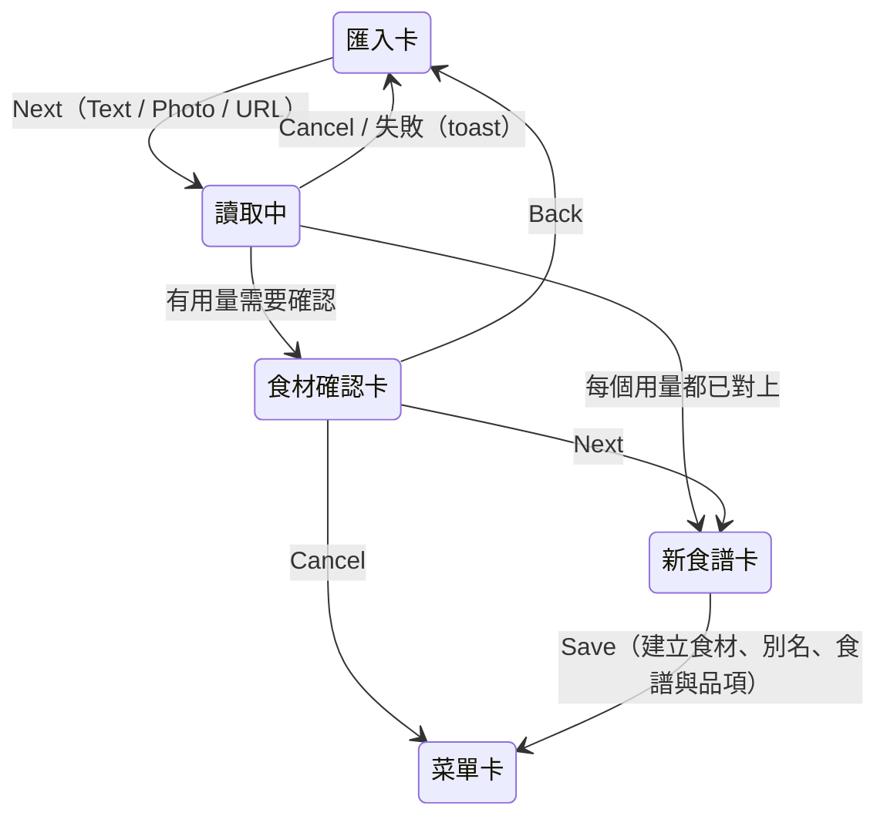
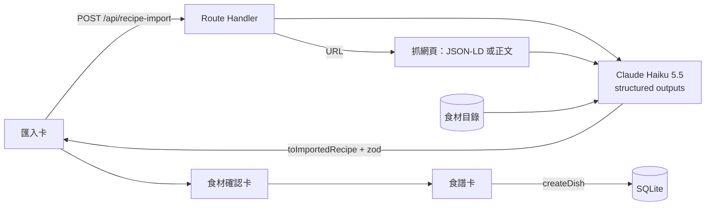

# 食譜匯入

## 一句話

在匯入卡貼文字、放照片 / PDF 或貼網址，由 Claude 整理成雙語的品項與食譜草稿，在食材確認卡決定每個用量對應哪個食材，再到食譜卡檢查、按 Save 寫入。

## 流程

- LLM 只產生草稿，不碰資料庫；所有寫入都經由食譜卡的 Save（[ADR-0022](../adr/0022-llm-import-with-haiku.md)）。
- 匯入結果與食材的決定由 `EditorLayer` 保管，和 Scratch 的菜名一樣，關閉編輯器或存檔後就丟棄；原文與上傳的檔案不保留。

## 規則 / 狀態

| 項目 | 規則 |
| ---- | ---- |
| 來源 | `Scratch`（手填）、`Text`（貼上）、`Photo`（JPEG / PNG / WebP / PDF，可多個、可拖放）、`URL` |
| 讀取中 | Next 變成 `Spinner` 與 `Reading…`，輸入鎖住；Cancel 或離開卡片會中止請求 |
| 成功 | 菜名與描述填回 Scratch 欄位並切到 Scratch；之後在 Scratch 按 Next 仍沿用這次匯入的結果 |
| 網址 | 只抓公開的 `http(s)` 網址，每次轉址都檢查；先讀頁面的 JSON-LD `Recipe`，沒有就抽正文；網址加進 References（[ADR-0023](../adr/0023-url-import-extraction.md)） |
| 整理內容 | 一次產生 en / zh；修順句子；敘述拆成步驟、必要時分組並加 Highlight；原文沒寫的量留空、不猜；只在步驟出現的食材補成一行用量 |
| 單位 | 只用單位清單（[ADR-0024](../adr/0024-more-units.md)）；清單外的寫法數量照填、不帶單位；沒有數量的用量在食譜紙顯示 To taste |
| 步驟引用用量 | LLM 標出每一步提到的用量行，存檔後成為步驟片段的 `lineId`（[ADR-0015](../adr/0015-step-text-references-lines.md)）；在食譜卡改過的步驟退回純文字 |
| 食材對應 | 每行用量對到目錄裡的食材、建議新增，或不連結；粒度：價格或營養明顯不同才算不同食材 |
| 食材確認卡 | 每行一列，狀態 `Matched`（寫法已是名稱或別名）、`Alias`（意思相同、寫法不同）、`New`、`Not linked`；需要處理的在上，Matched 摺疊在下 |
| 改對應 | 下拉選單：目錄食材、這次的新食材、`+ New ingredient`、`Not linked` |
| Alias | 預設勾選「Add as an alias」，存檔時把這行的寫法加為該食材的別名 |
| 新食材 | 名稱（隨 `EN \| ZH`）、別名（逗號分隔）、每 100 g 營養；LLM 估的營養標 `Estimated`，手動改過就取消標記（[ADR-0025](../adr/0025-imported-ingredients.md)） |
| 擋下 Next | 新食材沒有名稱，或與目錄中的食材同名（提示改成連結） |
| 跳過確認卡 | 每一行都是 Matched |
| 存檔 | 新食譜的 Save 在同一個 transaction 中加別名、建立仍被引用的新食材、建立食譜與品項；用量行改過名稱就照名稱重新比對 |
| 重新整理 | 匯入結果只在記憶體，確認卡與新食譜卡回到匯入卡，不會自動重新呼叫 |
| 失敗 | 餘額不足、逾時、拒答、抓不到網頁、找不到食譜等都顯示 toast，保留輸入 |

## 參數

- 模型、思考程度、逾時、檔案與網頁上限：見 `src/features/recipe-import/config.ts`。（待校準）
- prompt：見 `src/features/recipe-import/prompt.ts`；LLM 輸出格式：`src/features/recipe-import/llm-output.ts`。
- 確認卡的底色與尺寸：見 `src/app/globals.css` 的 `--editor-review-card*`。（待校準，先與菜單卡同色）

## 已知限制

- 每次匯入約 30 秒；畫面只有 Spinner，沒有進度（#83）。
- 要 JavaScript 才有內容、要登入或擋爬蟲的網頁抓不到（Instagram、YouTube 等）；改貼文字或截圖（#84）。
- 目錄選單是原生下拉選單，只能用打字跳到開頭相符的項目，不能模糊搜尋（#82）。
- 匯入只能新增品項；不能用指令修改既有食譜，也不能匯入成不在菜單上的食譜（等食譜庫 #57）。
- 新食材只有名稱、別名與估計營養；價格與營養計算見 #42。

## 相關連結

- ADR：[ADR-0022](../adr/0022-llm-import-with-haiku.md)、[ADR-0023](../adr/0023-url-import-extraction.md)、[ADR-0024](../adr/0024-more-units.md)、[ADR-0025](../adr/0025-imported-ingredients.md)
- 計畫：[PLAN-007](../plans/PLAN-007-llm-import.md)
- 外部服務：[資料來源](../data-sources.md)
- Issue：#52
