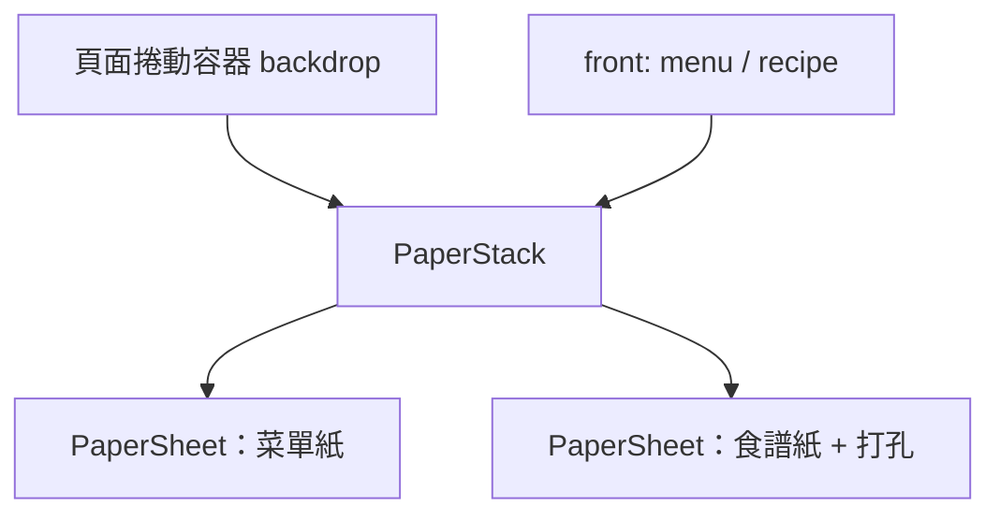

# PLAN-002：紙張堆疊版面與換紙動畫

## 目標

參考 [Obys Design Books](https://library.obys.agency/)，把首頁從「左右攤開的菜單書」改成「疊在一起的紙張」：上層是單欄菜單，下層是有打孔的食譜紙。點擊品項時兩張紙帶著旋轉往下收、再往上冒出，上下層互換。先專心做這一種風格，不滿意再整個換掉。

## 非目標

- 兩張以上的紙、紙張 hover 浮起等額外互動
- 食譜的正式排版（本步只顯示純文字）
- 食譜路由與網址（`/recipes/[id]`）、瀏覽器上一頁返回
- 窄螢幕版面（#10）
- 翻頁（`FlipView`，[ADR-0004](../adr/0004-custom-page-flip.md)）
- 資料庫

## 驗收條件

- 頁面背景是深色底（新 token），上面疊兩張紙；兩張紙都套用紙張材質，混合模式為 `overlay`。
- 上層紙（菜單紙）：現有菜單內容改為單欄，配色沿用現有 token；版面參照 `epifolio-ui.webp`。
- 下層紙（食譜紙）：底色 `primary`、文字 `primary-foreground`，往右下錯開，露出的右側有一排真正透明的圓洞，能透過洞看到底下的東西。
- 頁面捲動時兩張紙一起移動。
- 點擊品項：兩張紙往下離開畫面 → 上下層互換 → 往上回到原位。過程中帶旋轉，起點與終點都擺正；兩張紙最終的 x、y 不變，只有疊放順序改變。
- 互換後食譜紙在上層，顯示被點擊品項對應的食譜（純文字）。
- 食譜紙在上層時，點擊露出的菜單紙邊緣會換回菜單，動畫相同。
- 系統設定減少動態效果時，不播放收起與冒出，直接互換。
- 淺色與深色模式都正常顯示。
- 紙張尺寸、錯開距離、洞的尺寸與間距、材質透明度放在 `globals.css` 的 design tokens；動畫時長、旋轉角度、緩動曲線集中在單一設定檔。
- `pnpm typecheck`、`pnpm lint`、`pnpm format:check` 通過。

## 邊界情況

- 收起時已經往下捲：位移量依當下捲動位置計算，確保紙張完全離開畫面；冒出前捲回頂端。
- 動畫進行中再次點擊：忽略，不排入佇列。
- 兩張紙高度不同：捲動高度以較高的那張為準，短的那張不會被裁掉。
- 品項沒有對應食譜：不可點擊（mock 資料目前每道菜都有）。

## 設計摘要

**素材**：`~/Desktop/paper-texture-1.webp` 移到 `public/textures/paper.webp`。要用在 CSS `background-image`，所以放 `public/`；改成用途導向的檔名，之後換材質不用改程式碼。材質本身偏暗，`overlay` 會讓紙色變深，紅色紙特別明顯，所以透明度做成 token，之後再調。

**新增 token**（數值先由我定，之後可改）

| token | 用途 | 淺色 | 深色 |
| ----- | ---- | ---- | ---- |
| `--backdrop` | 紙張後面的頁面底色 | `#1c1a12` | `#14160b` |
| 菜單紙底色 | 沿用 `--background` | — | — |
| 食譜紙底色 / 文字 | 沿用 `--primary` / `--primary-foreground` | — | — |

**打孔**：用 CSS `mask-image`（`radial-gradient` 沿右側垂直重複）挖出真正的透明洞，任何下層內容都能透出來，不需要 WebGL。用了 mask 之後 `box-shadow` 會被一起遮掉，所以陰影改用外層元素的 `filter: drop-shadow`。

**結構**

- `PaperStack` 只管疊放順序、位置與動畫；紙上的內容由外部傳入（菜單、食譜各自的元件）。
- 兩張紙在同一個捲動容器裡，各自 absolute 定位，所以會一起捲動。

**動畫**（用現有的 `motion`）：每張紙用 keyframes `y: [0, 離開畫面, 0]`、`rotate: [0, ±θ, 0]`，在最低點互換 `z-index`。兩張紙的旋轉方向與時間稍微錯開，看起來比較像兩張獨立的紙。

**資料**：食譜與品項維持不同型別。新增 `src/features/recipe/`，包含 `Recipe` 呈現型別與從 mock 資料轉換的函式；`MenuItem` 增加 `recipeId` 引用食譜。單欄之後就不需要 `MenuSpread` 與 `splitIntoSpread`，會一併移除。

**ADR**：「紙張堆疊取代左右跨頁」是版面方向的取捨，會新增 ADR-0007。

**返回菜單**：點擊下層露出的菜單紙邊緣就換回來，播放同樣的收起再冒出動畫。不另外加按鈕。

**頁首**：網站標題在紙張外的左上角，色彩模式切換在紙張外的右上角。

## 任務拆解

1. #14 素材與 token：搬移材質、新增 backdrop / 紙張尺寸 / 打孔 / 材質 token
2. #15 `PaperSheet` 與 `PaperStack` 的靜態版面：兩層紙、錯開、打孔、一起捲動
3. #16 菜單紙：單欄菜單內容、頁首移到紙外、移除 `MenuSpread`
4. #17 食譜資料與食譜紙：`Recipe` 型別、轉換函式、`MenuItem.recipeId`、純文字食譜
5. #18 換紙動畫：點擊品項觸發、旋轉收起再冒出、返回菜單、減少動態效果

## 完成後遷移清單

- [x] 功能頁：`docs/features/menu-book.md` 改寫並改名為 `docs/features/paper-stack.md`
- [x] ADR：`docs/adr/0007-paper-stack-layout.md`
- [x] glossary：新增 `PaperStack`、`PaperSheet`，移除 `MenuSpread`
- [x] `docs/architecture.md`：新增 `src/features/recipe/`、`src/features/paper-stack/`、`public/textures/`
