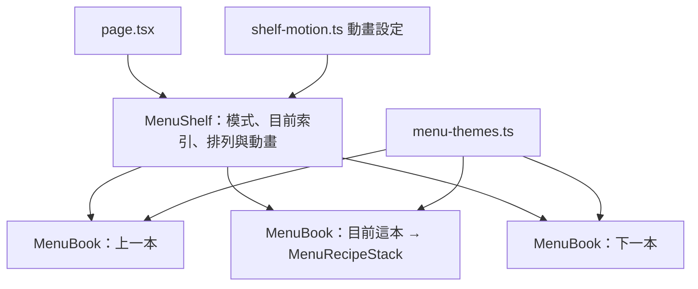

# PLAN-003：多本菜單書與菜單總覽

## 目標

讓首頁能同時擁有多本菜單書（`MenuBook`）：每本有自己的配色（`MenuTheme`），目前這本在畫面正中間，左右兩側露出上一本與下一本；右上角的 menu 按鈕切到總覽，把所有書縮小排成一列，用滾輪左右切換。這次只做 UI，資料仍是 mock。順便移除色彩模式（`ColorMode`），全站固定使用目前的淺色配色。

## 非目標

- 新增菜單書的表單、資料庫、持久化（之後另開 issue）
- 使用者自訂配色（這次只有寫在程式碼裡的幾組 `MenuTheme`）
- 窄螢幕版面（#10）
- 觸控滑動手勢（這次只做滑鼠滾輪與觸控板）
- 菜單字型、頁面樣式等其他 `MenuTheme` 屬性（這次只有顏色）

## 驗收條件

**移除色彩模式**

- 移除 `next-themes`、`ThemeProvider`、`ThemeToggle`、`.dark` 區塊、`.dark` 材質透明度、色彩模式 View Transition 的 CSS。
- `src/components/ui/` 裡的 `dark:` class 全部移除；`sonner.tsx` 不再依賴 `next-themes`。
- 系統設為深色時，畫面與淺色時完全相同。
- 文件中「色彩模式」相關內容同步移除或改寫（glossary、architecture、coding rules、ADR-0003 加註、README）。

**配色（MenuTheme）**

- 每本菜單書套用自己的 `MenuTheme`，書內所有語意 token（`bg-background`、`text-primary`…）自動換成該配色，元件不需要知道是哪一本。
- 第一組 `MenuTheme` 就是目前的淺色配色，同時也是網站外框（頁首、對話框、toast）的預設配色。
- 先提供 4 組配色（數值見設計摘要，之後可調）。

**閱讀模式（預設）**

- 目前的書在正中間，位置與現在相同；左側露出上一本、右側露出下一本，只露出一部分，被畫面邊緣裁切。
- 書數 ≥ 3 時無限循環：中間是第一本時，左側是最後一本。
- 書數 = 2 時不循環：中間是第一本時只有右側有書，中間是第二本時只有左側有書。書數 = 1 時兩側都沒有。
- 點左右露出的書：整排往反方向平移，被點的書移到正中間。平移時每本書以頂端為軸微微傾斜（下緣領先），停下時擺正。
- 只有中間那本可以捲動、點品項換紙（沿用 PLAN-002 的換紙動畫）；兩側的書不能互動，只能被點擊切換。

**總覽模式**

- 右上角改為文字按鈕 `menu`（標題字型），取代色彩模式切換。
- 點擊後所有書從原位置以動畫縮小、移到一列；原本中間那本落在左數第二格（附圖 `epifolio-ui-menu`）。
- 總覽時每本書的食譜紙空白（沒有內容），書的高度固定，整本可見。
- 滾輪上下滾動 → 書本左右移動，每次停在一本的位置（卡點）；書數 ≥ 3 時循環。
- 點任一本 → 動畫回到閱讀模式，被點的書在正中間。
- 總覽時再點 `menu` → 回到閱讀模式，中間是進入總覽前的那本。

**共通**

- 系統設定減少動態效果時：不播放平移、傾斜、縮放，直接切換。
- 動畫進行中的點擊與滾輪輸入忽略，不排入佇列。
- 尺寸、間距、縮放比例放在 `globals.css` token；動畫時長、傾斜角度、緩動曲線、滾輪門檻集中在單一設定檔。
- `pnpm typecheck`、`pnpm lint`、`pnpm format:check` 通過。

## 邊界情況

- 閱讀模式中，中間的書已往下捲或食譜紙在上：切到別本或進總覽時，該本捲回頂端並換回菜單紙在上。
- 觸控板慣性：一次手勢只移動一本，慣性尾巴不會連續觸發（見設計摘要「滾輪卡點」）。
- 書數 = 2 的總覽：不循環，滾到頭就停。
- 視窗縮放：位置以 token 計算，縮放後重新排列，不殘留動畫中途的位置。

## 設計摘要

### 1. 移除色彩模式

刪除 `src/components/theme-provider.tsx`、`theme-toggle.tsx`，`layout.tsx` 拿掉 `ThemeProvider` 與 `suppressHydrationWarning`，移除 `next-themes` 套件。

注意：Tailwind v4 在沒有自訂 `dark` variant 時，`dark:` 預設跟隨系統的 `prefers-color-scheme`。所以只刪 `.dark` 區塊不夠，`dark:` class 也要一起刪；之後用 shadcn CLI 加新元件時也會帶進 `dark:`，因此保留一行 `@custom-variant dark (&:where(.never-dark *))` 讓它永遠不生效，並加註原因。（若你偏好完全不留，改成每次加元件後手動刪 `dark:`。）

### 2. 配色管理（回答你的第 3 點）

業界成熟做法是**兩層 token + 範圍套用（scoped theming）**，shadcn、Radix Themes、Material 3 都是這個模式：

1. **語意 token**（semantic）：元件只認 `--background`、`--foreground`、`--primary`… 這些「用途」名稱，現在已經是這樣。
2. **配色組**（theme）：一組配色 = 一組語意 token 的值。在某個元素上設定這組變數，它底下的所有子元素就用這組顏色。CSS 變數本來就會往下繼承，Tailwind 的 `@theme inline` 也是讀變數，所以 `bg-primary` 在第一本是紅、在第二本是芥末黃，元件完全不用改。

專案的 glossary 已經有這個概念：**菜單主題 `MenuTheme`**（顏色、字型、頁面樣式）。這次就用它，不另創 palette 之類的詞；這次只實作顏色部分。

**存放位置**：建議放 TS 單一設定檔 `src/features/menu-theme/menu-themes.ts`，每組有 `id` 與顏色值；書的根元素用 inline style 寫入 CSS 變數（`style={{ "--background": ... }}`）。

| 方案 | 說明 | 取捨 |
| ---- | ---- | ---- |
| **A. TS 設定檔 + inline CSS 變數**（建議） | 配色是資料，書以 `themeId` 引用 | 之後存進資料庫、做配色選擇器、使用者自訂配色都不用改結構；但顏色值不在 `globals.css` |
| B. `globals.css` 的 `[data-menu-theme="olive"]` 區塊 | 書加 `data-menu-theme` 屬性 | 跟現有 token 放一起；但 id 要在 CSS 與 TS 各寫一次，使用者自訂配色時無法用 |

第一組（`classic`）同時寫進 `:root` 作為網站外框的預設值。`:root` 只保留不隨書變動的 token（`--backdrop`、`--radius`、紙張尺寸等）以及預設配色。

**每組配色的 token**（使用者提供；之後可調，正式數值以設定檔為準）：

| token | 用途 | classic | olive | navy | cocoa |
| ----- | ---- | ------- | ----- | ---- | ----- |
| `--background` | 菜單紙底色 | 現值 | `#363B20` | `#202C3C` | `#4B3326` |
| `--primary` | 大標、食譜紙底色 | 現值 | `#CAB274` | `#9B5B39` | `#A7A87F` |
| `--foreground` | 菜單紙文字 | 現值 | `#CED2BE` | `#929291` | `#C3B0A4` |
| `--primary-foreground` | 食譜紙文字 | 現值 | 預設等於 `--background` | 同左 | 同左 |
| 材質透明度 | 深色紙要降低 | 現值 | 較低 | 較低 | 較低 |

食譜紙維持用 `--primary`，跟大標同色，不另外加 token。品項描述文字沿用 `--foreground`（與現在相同，`MenuItemRow` 只用細字重區分），不需要另外的顏色。shadcn 其餘 token（`card`、`popover`、`secondary`…）由這幾個值用 `color-mix()` 推算，避免每組要填二十幾個值。材質透明度也放進配色，取代原本 `.dark` 的材質調整。

這是資料結構與儲存方式的取捨，需要 **ADR-0008**（菜單主題的配色管理）。

### 3. 資料

- 新增 **菜單書 `MenuBook`**：`{ id, themeId, group }`，一本書顯示一個大類（`MenuGroup`），等於用「換本」解決 #21（大類切換）。
- mock 先做 4 本，各對應一個大類與一組配色（目前只有 Main 有足夠內容，其他本先沿用重複內容，像附圖一樣）。
- 這次不放「新增菜單」的按鈕或佔位。

### 4. 版面與動畫

- 新增 **書架 `MenuShelf`**（`src/features/menu-shelf/`）：管模式（`reading` / `overview`）、目前索引、每本書的位置；位置是純函式 `slotOf(index, current, count, mode)`，循環規則、書數 2 的不循環規則都在這裡，可單獨測試。
- 頁首移出 `PaperStack`，固定在書架上層；頁面不再整頁捲動，改成只有中間那本有自己的捲動區。
- **平移傾斜**：用 `motion` 的 keyframes，`x` 移到新位置，同時 `rotate: [0, ±θ, 0]`、`transform-origin` 在頂端，往右移時逆時針轉，下緣就會比上緣先到。各書錯開一點時間。
- **總覽**：每本書同時動畫 `x`、`y`、`scale` 到總覽格位；中間那本的格位是左數第二格。

### 5. 滾輪卡點（回答你的第 5 點）

CSS `scroll-snap` 只適用原生捲動軸，但這裡是「垂直滾輪 → 水平移動」而且要循環，原生 snap 做不到。觸控板的難處在於：一次輕撥會送出一連串 wheel 事件，加上慣性尾巴，自己寫門檻 + 冷卻時間很容易一撥跳兩本。

| 方案 | 取捨 |
| ---- | ---- |
| **A. `wheel-gestures`**（建議） | 小型、無相依的函式庫，專門辨識「一次手勢」的開始、結束與慣性（Embla 的滾輪外掛就是用它）。我們拿到「一次手勢、方向」後，自己用 `motion` 移動一本，跟傾斜動畫、循環邏輯不衝突。 |
| B. Embla Carousel + wheel 外掛 | 卡點、循環現成；但 Embla 自己控制 transform，和我們的傾斜、總覽縮放動畫會搶控制權。 |
| C. 自己寫門檻 + 冷卻 | 不加套件；觸控板慣性常誤觸，需要反覆調參數。 |

先加入 `wheel-gestures`，完成後交給使用者實際測試觸控板與滑鼠手感，再決定留下（寫 ADR-0009）或改用方案 C（移除套件）。

## 任務拆解

1. #24 移除色彩模式：`next-themes`、provider、toggle、`.dark`、`dark:` class、相關文件
2. #25 `MenuTheme`：配色設定檔、套用方式、推算 token、材質透明度、ADR-0008
3. #26 `MenuBook` 資料與 mock：4 本書，各引用一個大類與配色
4. #27 `MenuShelf` 閱讀模式靜態版面：中間 + 左右露出、循環與書數 2/1 的規則、頁首移出
5. #28 閱讀模式切換動畫：點兩側的書平移 + 傾斜、減少動態效果
6. #29 總覽模式：`menu` 按鈕、縮放排列動畫、食譜紙空白、點書回到閱讀模式
7. #30 總覽滾輪卡點：`wheel-gestures`、一次一本、循環；使用者測試後決定去留，留下則寫 ADR-0009

## 完成後遷移清單

- [x] 功能頁：新增 `docs/features/menu-shelf.md`；`paper-stack.md` 移除色彩模式、更新頁首
- [x] ADR：`0008-menu-theme-colors.md`、`0009-shelf-wheel-snap.md`；ADR-0003 加註不再支援 dark
- [x] glossary：新增 `MenuBook`、`MenuShelf`；更新 `MenuTheme`；移除 `ColorMode`
- [x] `docs/architecture.md`：新增 `src/features/menu-theme/`、`src/features/menu-shelf/`，移除 `next-themes`
- [x] `.claude/rules/coding.md`：顏色規範改寫（不再有 `.dark`）
- [x] `README.md`：技術棧移除 next-themes
- [x] #21 以本計畫結案
