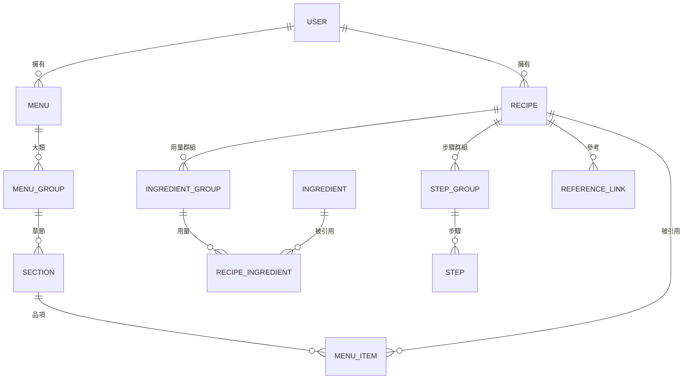
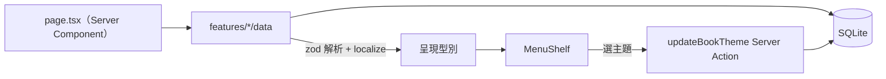

# PLAN-005：資料庫基礎與菜單書主題切換

## 目標

1. 菜單、食譜、食材從 mock JSON 搬進 SQLite（Prisma），首頁改讀資料庫，**畫面與互動完全不變**。
2. 資料模型一次預留之後幾份計畫需要的結構：中英雙語內容、多人使用、步驟文字引用用量行、LLM 匯入要填的格式。
3. 每本菜單書可以從現有菜單主題中挑一組，選擇存進資料庫，作為第一個寫入資料庫的功能。

## 非目標

- 食譜、菜單、食材的編輯表單與新增、刪除（下一份計畫）
- LLM 匯入、營養估計、自動新增食材
- 雙語介面與切換語言；這次一律顯示英文，資料庫只是留好欄位
- 食材價格紀錄、成本、營養計算、單位換算（#42）
- 步驟中食材的用量互動（hover / 點擊）；這次只做資料結構，mock 步驟不建立連結
- 登入與帳號系統；只建一個預設使用者
- 圖片上傳；食譜圖片欄位先不建
- mock 中目前沒有顯示的欄位：`rating`、`difficulty`、`tags`、`signature`、`inMenu`、`timesCooked`、`lastCooked`（需要時再開 issue）

## 驗收條件

**資料庫與 seed**

- `prisma/schema.prisma` 包含設計摘要 2 的 model；`pnpm exec prisma validate` 通過，有一個 migration。
- `pnpm exec prisma db seed` 可在空資料庫重複執行（先清空再寫入），寫入預設使用者、全部菜單、食譜、食材。
- mock 的 `originalName`（如「蘑菇濃湯」）寫進食譜名稱的 `zh`；其他文字只有 `en`。
- 食譜原份數、時間、筆記、用量（數量、範圍、單位、寫法、備註、食材引用）、步驟（標題、分鐘、文字）與 mock 一致。

**首頁讀資料庫**

- `src/app/page.tsx` 改由資料存取函式取得菜單書、食譜、食材，不再 import mock loader。
- 與合併前的 `main` 比對：八本菜單書的順序、配色、菜單內容、食譜紙內容、食材卡片內容一致（截圖逐本比對）。
- 份數換算、勾選、食材卡片照常運作；勾選改以用量行 id 為 key。

**主題切換**

- 每本書在閱讀模式有一個主題選單（位置見設計摘要 5），列出 `menu-themes.ts` 的所有主題，標示目前選中的。
- 選了之後該書立即換色，並存進資料庫；重新整理後維持。
- 存檔失敗時還原原本的主題並顯示 toast。
- Server Action 以 zod 驗證 `themeId` 必須是現有主題；不合法的值回傳錯誤，不寫入。

**共通**

- `pnpm typecheck`、`pnpm lint`、`pnpm format:check` 通過；瀏覽器實測依 R4 確認點擊目標。
- 元件不 import Prisma 型別，只依賴 `src/features/*/types.ts` 的呈現型別。

## 邊界情況

- 資料庫是空的（沒跑 seed）：首頁顯示空書架，不報錯；README 寫明要先跑 seed。
- 雙語欄位只有一種語言：顯示有的那種；兩種都沒有時顯示空字串，不報錯。
- 步驟文字片段引用的用量行已不存在：該片段當一般文字顯示。
- 資料庫裡的 `themeId` 已不在 `menu-themes.ts`（主題被移除）：用預設主題顯示，不改寫資料庫。
- 用量的單位不在單位清單：seed 時報錯並指出是哪一行，不默默略過。
- 目前除了 Main 以外的大類沒有菜色，mock 以 Main 的章節當佔位內容：seed 照樣建立這些章節與品項（品項引用同一份食譜，食譜與菜單本來就是多對多），畫面才能一致。

## 設計摘要

### 1. 共通規則

| 規則 | 做法 |
| --- | --- |
| 雙語內容 | 欄位層 JSON `{ en?: string, zh?: string }`；畫面用 `localize(text, locale)` 取值並退回另一種語言。決策見 [ADR-0013](../adr/0013-localized-json-fields.md) |
| JSON 欄位的型別 | Prisma 的 `Json` 沒有型別；資料存取層一律用 zod 解析後才交給元件 |
| 排序 | 有順序的資料用 `position Int` |
| 多人預留 | 使用者資料（菜單、食譜）有 `userId`；食材目錄是共用資料，沒有 `userId`。`getCurrentUserId()` 目前固定回傳預設使用者 |
| 固定清單 | 菜單主題 id、用量單位存成字串，在程式碼的清單中驗證，不用資料庫 enum（新增選項不用 migration） |
| id | 新資料用 `cuid()`；seed 沿用 mock 的 id（例如 `garlic`），食材照片路徑因此不變 |

### 2. 資料模型

| Model | 主要欄位 |
| --- | --- |
| `User` | `id`、`name` |
| `Menu` | `userId`、`title`（雙語）、`currency` |
| `MenuGroup` | `menuId`、`label`（雙語）、`themeId`、`position`；一個大類就是一本菜單書 |
| `Section` | `groupId`、`label?`（雙語）、`position` |
| `MenuItem` | `sectionId`、`recipeId`、`name`（雙語）、`description?`（雙語片段：`{ en?: Part[], zh?: Part[] }`，`Part = { text, ingredientId? }`）、`price`、`position` |
| `Recipe` | `userId`、`name`（雙語）、`serves?`、`timeMinutes?`、`notes`（雙語字串陣列） |
| `IngredientGroup` | `recipeId`、`label?`（雙語）、`position` |
| `RecipeIngredient` | `groupId`、`ingredientId?`、`quantityMin?`、`quantityMax?`、`unit?`、`name`（雙語）、`note?`（雙語）、`position` |
| `StepGroup` | `recipeId`、`label?`（雙語）、`position` |
| `Step` | `groupId`、`title?`（雙語，選填重點）、`minutes?`、`text`（雙語片段：`Part = { text, lineId? }`，`lineId` 指向 `RecipeIngredient.id`）、`position` |
| `ReferenceLink` | `recipeId`、`url`、`label?`、`position`（mock 沒有資料，先建表） |
| `Ingredient` | `name`（雙語）、`aliases`（字串陣列，給之後的 LLM 對應）、`image?`、`priceAmount?`、`priceUnit?`、`calories?`、`protein?`、`carbs?`、`fat?`（每 100 g） |

- 數量：單值存 `quantityMin`，範圍另存 `quantityMax`；兩者都空代表沒有數量（如 to taste）。
- 價格與營養先照目前的單一值存，#42 會改成購買紀錄。
- 食材的 `name` 是雙語，用量的 `name` 保留食譜裡的寫法，兩者分開（同 ADR-0011）。

### 3. 程式結構

- 資料存取：各功能模組的 `data/`（如 `src/features/recipe/data/get-recipes.ts`），`server-only`，回傳現有的呈現型別。
- 呈現型別小改：`RecipeIngredient` 加 `id`、`Step.title` 改選填、`Step.text` 改為片段陣列；元件在這次仍把片段串成文字顯示。
- 單位清單放 `src/features/recipe/units.ts`，seed 與之後的表單共用。
- `localize()` 與雙語型別放 `src/lib/i18n/`（只放內容取值，介面字典留給之後的計畫）。
- `getCurrentUserId()` 放 `src/lib/current-user.ts`。
- seed：`prisma/seed.ts` 讀 mock JSON；用量字串解析從 `mock-recipes.ts` 移過去。完成後刪除 `src/features/*/lib/mock-*.ts`，mock JSON 移到 `prisma/seed-data.json`。

### 4. 首頁資料流

### 5. 主題切換

- Server Action `updateBookTheme(groupId, themeId)`：zod 驗證、確認該大類屬於目前使用者、寫入、`revalidatePath("/")`。
- 畫面先換色（`useOptimistic`），失敗時還原並顯示 toast。
- 選單位置：閱讀模式下目前這本書的菜單紙右上角（chef name 旁）放一個小按鈕，點開是 `DropdownMenu`，每個選項顯示主題名稱與色塊。只有置中的那本可操作；總覽模式不顯示。**待使用者確認。**

## 任務拆解

1. ADR：資料模型（雙語 JSON 欄位、預設使用者與 `userId`、用量行 id 與步驟片段、單位清單、固定清單不用 enum）（#45）
2. Prisma schema、migration、`getCurrentUserId()`、`localize()` 與雙語型別、單位清單（#46）
3. seed：mock JSON 轉成資料庫資料（含用量解析、佔位章節、`originalName` → `zh`）；README 加上 seed 步驟（#47）
4. 資料存取層與首頁改讀資料庫；呈現型別調整、勾選改用行 id；刪除 mock loader；截圖比對（#48）
5. 菜單書主題切換：Server Action、選單 UI、樂觀更新與錯誤處理（#49）
6. 文件：architecture、glossary、功能頁、ADR 索引、STATUS（#50）

## 完成後遷移清單

- [ ] ADR：0013–0016（任務 1）；ADR-0011 的「資料庫化時再確認」改為連到新 ADR
- [ ] `docs/architecture.md`：ER 圖、資料流、「待決定」段落、目錄結構（`data/`、`src/lib/i18n/`、`prisma/seed.ts`）
- [ ] `CLAUDE.md` 第 4 節目錄結構
- [ ] 功能頁：`docs/features/menu-shelf.md` 加主題切換；`features/index.md`
- [ ] glossary：使用者 `User`、雙語文字 `LocalizedText`、步驟片段、單位清單
- [ ] README：seed 指令
