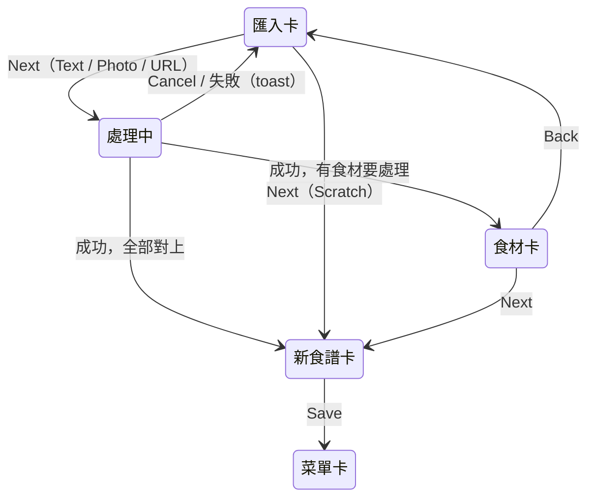
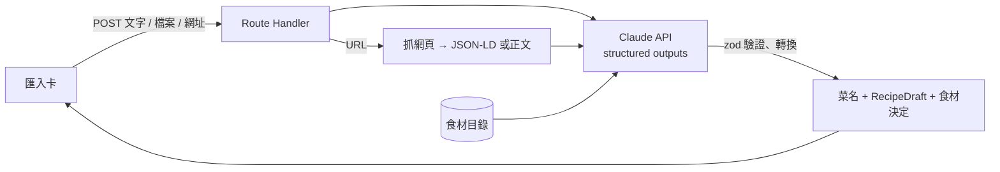

# PLAN-007：LLM 匯入食譜

## 目標

1. 匯入卡的 Text、Photo 可以用，另外新增 URL：把一段文字、照片 / PDF 或一個網址交給 LLM，整理成一道菜（品項名稱、描述）與一份食譜的草稿。
2. LLM 只產生草稿：結果通過與編輯卡相同的 zod schema，進入卡片讓使用者檢查、修改，按 Save 才寫入。直接編輯（Scratch）永遠可用。
3. 匯入時一起對應食材目錄：新增的「食材卡」集中處理對不上的食材（連到現有食材、加別名、新增食材），新食材可預填 LLM 估計的營養。
4. 單位清單補上常見單位；沒有數量的用量在食譜紙上顯示 To taste。

## 非目標

- 保留原文或上傳的檔案（匯入完就丟，不建匯入紀錄表）
- 記錄 token 用量（看 Claude Console 的用量報表）
- 影片；要登入或靠 JavaScript 才有內容的網頁（Instagram、YouTube 等）
- 用指令修改既有食譜（例如「改成 4 人份」）；匯入成不在菜單上的獨立食譜（等食譜庫 #57）
- 食材價格、既有食材的營養補填、食譜與品項的營養和成本計算、食材卡片顯示營養（#42）
- 時間、筆記、步驟分鐘數（#58）；步驟中顯示引用的用量（#54）；食譜圖片（#59）
- 主題款的載入動畫（先用 shadcn `Spinner`）

## 驗收條件

**匯入卡**

- 來源依序為 `Scratch`、`Text`、`Photo`、`URL`，都可以按 Next。
- Text：多行文字框，必填。
- Photo：點選或拖放；可放多個檔案（例如兩頁的食譜），接受 JPEG、PNG、WebP、PDF；顯示已選的檔名，可個別移除。格式、數量、大小上限見設定檔，超過時當場提示，不送出。
- URL：一個網址欄位，必須是 `http(s)` 網址。
- 按 Next 後按鈕顯示 `Spinner` 與 `Reading…`，卡片不能操作，只有 `Cancel` 可按；取消後回到可編輯狀態，輸入保留。
- 成功：菜名與描述填回匯入卡的 Scratch 欄位並切到 Scratch（使用者可再改）；接著有需要處理的食材時進入食材卡，沒有就直接進入已填好的食譜卡。
- 失敗（餘額不足、逾時、拒答、抓不到網頁、結果不符 schema）：顯示 toast，保留輸入，可重試。

**LLM 輸出**

- 模型 `claude-haiku-5-5`，ID 與參數放設定檔；以 structured outputs 取得固定格式，再用 zod 驗證。
- 一次產生 en / zh 兩種語言（ADR-0013）。
- 產生：品項名稱、品項描述（片段以 ` · ` 分隔）、食譜名稱、份數、用量群組與用量行（數量、單位、名稱、備註）、步驟群組與步驟（Highlight、內文）、原文中出現的網址（References；URL 匯入時含該網址）。
- 內容規則：保留原意與用量，修順句子；原文沒有明確步驟時拆成步驟，必要時分組並加 Highlight；原文沒寫的量留空，不猜；只在步驟出現的食材補成一行用量（量留空）；不加入原文沒有的食材。
- 單位只用單位清單；清單外的寫法（如「1 顆」）數量照填、不帶單位。
- 步驟內文標出引用的用量行（ADR-0015），存檔後成為步驟片段的 `lineId`。
- 每個用量對應食材目錄：一個現有食材 id、或「建議新增」（附中英名稱、別名、每 100 g 營養估計）、或不連結。粒度：價格或營養明顯不同才是不同食材（蒜粉 ≠ 蒜頭；蒜末、金黃蒜頭 = 蒜頭）。

**URL**

- 伺服器抓網頁（逾時、大小上限見設定檔），只接受 `http(s)`，拒絕 localhost 與內網位址。
- 先讀頁面中的 schema.org `Recipe`（JSON-LD）；沒有就抽出正文文字。結果當成文字交給 LLM。

**食材卡**

- 匯入成功、且有任一食材不是「完全對上」時出現；全部完全對上就跳過。
- 每列是食譜中的一種寫法，顯示寫法、出現位置（例如 `Sauce · 2 tbsp`）、對應結果與狀態：Matched / Alias / New / Not linked。需要處理的在上、Matched 在下並摺疊。
- 每列可改對應：從目錄搜尋挑選、改成新增、或不連結。
- Alias：勾選框「Add "<寫法>" as an alias」，預設勾選。
- New：中英名稱（隨 `EN | ZH` 切換）、別名（可增刪）、營養四格（kcal / protein / carbs / fat，每 100 g，標示 `Estimated`，可改可清空）。
- 新食材名稱不能空白，也不能與現有食材同名（提示改成連結）；否則不能按 Next。
- `Next` 進食譜卡、`Back` 回匯入卡（保留匯入結果，不重新呼叫 LLM）、`Cancel` 回菜單卡。

**存檔**

- 新食譜 Save 時，在同一個 transaction 中：建立新食材、加入別名、建立食譜與品項；用量行依食材卡的決定連結；步驟片段指向新建立的用量行。
- 在食譜卡改過名稱的用量行，照既有規則重新以名稱比對（`docs/features/editor.md`）；改過的步驟退回純文字片段（ADR-0015）。
- 中途 Cancel：什麼都不寫入。

**單位與 To taste**

- 單位清單加入 `pinch`、`cup`、`slice`、`piece`（含複數拼法），份數換算照常。
- 數量為空的用量，食譜紙顯示 `To taste`（有單位時照原樣顯示，例如 `tbsp`）。

**設定與文件**

- `ANTHROPIC_API_KEY` 只在伺服器讀取；`.env.example`、`README.md` 補上。
- 新增 `docs/data-sources.md`；`docs/vision.md` 的非目標移除「外部 API 整合」。

**共通**

- UI 文字英文；只用語意 token；`pnpm typecheck`、`pnpm lint`、`pnpm format:check` 通過；瀏覽器實測依 R4，會寫入資料庫的測試先備份 `dev.db`。
- 實測會呼叫 API 花錢：每次實測前告知使用者，用少量固定範例（文字、照片、PDF、網址各一）。

## 邊界情況

- 空白文字、沒選檔案、網址格式錯：Next 停用。
- 照片不是食譜（風景照）或文字不是食譜：LLM 回報「找不到食譜」，顯示 toast，不進下一張卡。
- iPhone 的 HEIC：不支援，提示改用 JPEG / PNG。
- 原文沒有菜名：LLM 依內容取名。原文只有一種語言：另一種由 LLM 翻譯。
- 原文沒有份數：`serves` 留空。
- 數量是範圍（`2-3`）或分數：照原樣轉成數量欄位可接受的格式。
- 同一食材多種寫法：食材卡分列顯示，各自決定。
- 兩列都建議新增同一個新食材：合併成一個新食材。
- 匯入結果不符 schema（例如單位不在清單）：該欄位清空後仍可進卡片；整體無法解析才算失敗。
- 在食材卡或食譜卡重新整理：匯入結果只在記憶體，回到匯入卡（不自動重新呼叫）。
- 取消時 LLM 請求仍在進行：中止請求，結果丟棄。
- 餘額歸零或超過每月上限：API 回錯誤，當一般失敗顯示 toast。

## 設計摘要

### 1. 流程

- 編輯器狀態機多一個 `ingredients` 卡（`?edit=ingredients:<bookId>:<sectionId>`，ADR-0017），轉場同匯入卡 → 食譜卡。
- 匯入結果（菜名、食譜草稿、食材決定）由 `EditorLayer` 保管，和 Scratch 的菜名一樣，關閉編輯器就丟棄。

### 2. 伺服器

- 用 Route Handler 而不是 Server Action：Server Action 的請求大小預設 1MB，放不下照片與 PDF；Route Handler 也能把使用者取消（`request.signal`）傳給 SDK 中止請求。實作前先讀 `node_modules/next/dist/docs/` 確認做法。
- 程式放 `src/features/recipe-import/`：設定檔（模型、上限、逾時）、prompt、LLM 輸出 schema、轉換成草稿的純函式、網頁抽取。LLM 輸出 schema 與編輯卡的草稿 schema 分開，轉換後再用 `recipeDraftSchema` 驗證。

### 3. 草稿與存檔的擴充

現在的草稿不帶食材連結（存檔時用名稱比對），新用量行沒有 id，步驟只有純文字。匯入需要：

- 用量行可帶 `ingredientId`（明確連結）或指向一個「待建立食材」的暫時 key，以及一個暫時 key 供步驟引用。
- 步驟可帶片段（引用用量行的暫時 key）；文字被改過就退回單一片段。
- `createDish` 多收「待建立食材」與「要加的別名」，同一個 transaction 寫入，再把暫時 key 換成真正的 id。

### 4. 食材卡外觀（先依現有 UI，使用者之後調整）

- 沿用編輯卡元件（卡紙材質、`EN | ZH`、底部按鈕列、捲軸）；底色另設一個 token，先與菜單編輯卡同色。
- 列的排版沿用食譜卡的用量行：寫法在左、對應結果在右；狀態用小型大寫標籤；編輯中只顯示欄位底線。
- 對應選單用 shadcn 既有的 `select` / `dropdown-menu`。

### 5. 待確認（以 ADR 草稿提出，確認後寫成 ADR）

| 決定 | 提案 | 替代方案 |
| --- | --- | --- |
| LLM 套件與模型 | `@anthropic-ai/sdk`、`claude-haiku-5-5`、structured outputs；LLM 只產生草稿 | Haiku 4.5（貴 10 倍、較舊）；直接打 HTTP（專案規範用官方 SDK） |
| 網頁抽取 | 先讀 JSON-LD `Recipe`，沒有再用 `@mozilla/readability` + `linkedom` 抽正文 | 整頁 HTML 給 LLM（token 多 10 倍以上，可能超過 10 萬 token 而價格變 5 倍）；讓 LLM 用 web fetch 工具（無法確認 Haiku 5.5 支援） |
| 單位清單 | 加 `pinch`、`cup`、`slice`、`piece`，保留原文單位 | 換算成公制（改動原食譜、體積換重量不準） |
| 營養估計值 | `Ingredient` 加 `nutritionEstimated`（布林），LLM 預填時為 true，使用者改過或 #42 確認後為 false | 不區分（之後無法分辨哪些是估計值） |
| 食材在何時寫入 | 食譜 Save 時與食譜同一個 transaction | 食材卡按 Next 就寫入（取消後留下沒用到的食材） |

## 任務拆解

1. ADR：LLM 套件與模型、網頁抽取、單位清單、營養估計值與食材寫入時機
2. 單位清單擴充與食譜紙的 To taste
3. 草稿 schema 與 `createDish` 擴充：明確食材連結、暫時 key、步驟片段、新食材與別名（含 `nutritionEstimated` migration）
4. LLM 匯入服務：SDK、設定檔、prompt、輸出 schema、轉換成草稿、Route Handler、錯誤對應
5. URL 抽取：抓網頁、JSON-LD、正文抽取、安全限制
6. 匯入卡：Text、Photo、URL 表單、載入狀態與取消、結果填回
7. 食材卡：狀態機新卡、列的狀態與修改、新食材表單、跳過規則、轉場
8. 文件：`editor.md`、`data-sources.md`、`vision.md`、`README.md`、`.env.example`、glossary、architecture、STATUS

## 完成後遷移清單

- [ ] 功能頁：`docs/features/editor.md` 補匯入與食材卡（或另開 `recipe-import.md`），`features/index.md`
- [ ] ADR：任務 1 的各項
- [ ] glossary：食材卡、匯入來源等新詞
- [ ] `docs/architecture.md`：匯入資料流、`src/features/recipe-import/`；`CLAUDE.md` 第 4 節
- [ ] `docs/data-sources.md`（新建）、`docs/vision.md`
