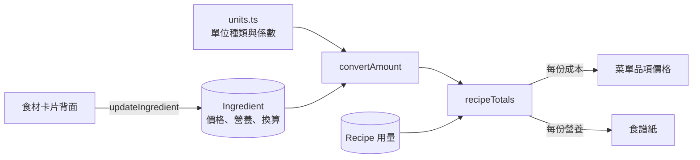

# PLAN-008：食材卡片翻面編輯、單位換算、料理成本與營養

## 目標

1. 食材卡片可以翻面編輯：名稱、價格、營養、單位換算、別名。目前食材資料只能靠 seed 或匯入建立，建立後就改不了。
2. 單位可以換算：通用單位（g、oz、tbsp…）用固定係數；瓣、顆、把這類計數單位，以及體積換重量需要的密度，記在各個食材上（ADR-0031）。
3. 用換算算出每道菜的食材成本與營養：菜單品項的價格等於食材成本加總，食譜紙顯示每份營養（ADR-0032）。

## 非目標

- 購買紀錄、平均價、購買地點（使用者決定只記一個價格）
- 食材列表／管理頁（#109）
- 換照片、圖片上傳（#59）
- 單位偏好設定，以及依偏好換算食譜顯示的單位（#110）
- 菜單描述片段的食材連結規則（使用者擱置，#108）
- 沒寫單位的用量在食譜紙上補顯示預設單位

## 驗收條件

**資料**

- 價格改為「金額 / 數量 單位」三個欄位（`priceAmount`、`priceQuantity`、`priceUnit` 存單位 id）；現有的 `"100 g"` 字串由 migration 轉換。
- 食材新增預設單位、計數單位的重量、密度（g/ml），以及「換算為估計值」的旗標。
- 單位清單加入 `head`（球）、`bunch`（把）、`stalk`（根）；每個單位標記它是重量、體積或計數，換算係數放在 `src/features/recipe/units.ts`。
- `MenuItem.price` 移除，價格改為讀取時計算；seed 跟著更新。
- 現有食材的換算數字由 Claude 估計後寫入資料庫，標記為估計值。

**食材卡片**

- 所有食材卡片同樣高度，以有照片、營養齊全的卡片為準；背面也一樣高，內容放不下時在卡片內捲動。
- 正面右上角有 edit 圖示，點了卡片翻面變成編輯頁；長尾夾在背面位於右上（示意圖）。
- 背面欄位：中英名稱、PRICETAG（價格 / 數量 / 單位）、NUTRITION（每 100 g）、UNITS（預設單位、各計數單位幾 g、密度）、ALIAS（逗號分隔），最下方 Save / Cancel。
- Save：驗證後寫入並翻回正面，畫面上依賴這個食材的價格與營養跟著更新。失敗時留在背面並顯示錯誤。Cancel 放棄修改並翻回正面。
- 編輯中點外面不會關閉卡片，也不能點其他食材換卡；Esc 視同 Cancel。換紙、換書、menu 照常關閉卡片（未存的修改放棄）。
- 營養表標明「每 100 g」。
- 手動改過營養值或換算值後，對應的估計旗標清除。
- 名稱與其他食材的名稱或別名相同時拒絕存檔。新加的別名和其他食材的名稱或別名相同時，也拒絕存檔。

**成本與營養**

- 換算與加總都寫成純函式，以假資料驗證：同單位、同類單位、經由重量換算、缺資料、範圍、沒有單位、適量等情況。
- 菜單品項價格：每份的食材成本（食譜沒寫份數時算整份）。有任何連到食材的用量算不出來時，價格後面加上標記表示不完整；完全算不出來就不顯示。
- 食譜紙在材料區下方顯示每份熱量、蛋白質、碳水、脂肪；不完整時同樣標記。這個區塊不隨份數控制變動。

**匯入**

- LLM 為每個新食材另外給預設單位、食譜用到的計數單位的重量、密度；新食材建立時寫入，標記為估計值。
- 實測遵守 R8：用 PLAN-007 的文字範例實測一次。

**共通**

- 新畫面的文字中英都寫進字典。
- `pnpm typecheck`、`pnpm lint`、`pnpm format:check`、`prisma validate` 通過。

## 邊界情況

- 範圍數量（80–100 g）取中間值計算。
- 沒有數量（適量）的用量不計入，也不算不完整。
- 沒連到食材的用量（例如煮麵的水）不計入。
- 沒寫單位但有數量（「洋蔥 1」）：視為食材的預設單位；食材沒有預設單位時視為 `piece`。
- 價格單位和用量單位相同時直接相除，不需要換算資料；同為重量或同為體積時用固定係數；其他情況經由公克換算。
- 換算鏈中缺任何一個數字（沒有密度、沒有該計數單位的重量）：這一行算不出來，結果標記為不完整。
- 價格只填一部分：金額有填但單位沒填，驗證失敗；數量留空視為 1；三欄都空表示沒有價格。
- 名稱兩種語言至少要有一種。
- 存檔時食材已被刪除：顯示找不到食材。

## 設計摘要

- 換算與加總都是純函式：`src/features/ingredient/lib/convert.ts`、`src/features/recipe/lib/recipe-totals.ts`。`page.tsx` 讀出食譜與食材後計算，結果附在食譜與品項上傳給前端，存檔後 `refresh()` 會重新計算。
- 翻面沿用編輯卡的 `FlipCard`。卡片的編輯狀態放在 `useIngredientCard`，讓圖層與換卡邏輯都讀得到。
- 背面表單用 react-hook-form + zod，Server Action `updateIngredient` 驗證後寫入。
- 取捨見 ADR-0031（換算資料放哪、資料庫保留原文單位）與 ADR-0032（價格即時計算、不存）。

## 任務拆解

1. 資料：單位種類與係數、Ingredient 欄位與 migration、移除 `MenuItem.price`、seed、現有食材的換算估計（#103）
2. 換算與成本／營養的純函式與驗證；菜單價格與食譜紙營養的顯示（#104）
3. 食材卡片：統一高度、edit 圖示、翻面、背面表單、`updateIngredient`（#105）
4. 匯入：LLM 輸出換算資料、新食材寫入；實測（R8）（#106）
5. 文件：`ingredient-card.md`、`recipe-import.md`、glossary、ADR、STATUS（#107）

## 完成後遷移清單

- [x] 功能頁：`docs/features/ingredient-card.md`（翻面編輯）、新增 `docs/features/dish-totals.md`（成本與營養）、`docs/features/recipe-import.md`
- [x] ADR：ADR-0031、ADR-0032
- [x] glossary：單位種類、計數單位、預設單位、密度、單位換算、料理成本與營養、估計換算
- [x] `docs/architecture.md`、`docs/vision.md`（非目標：購買紀錄）
