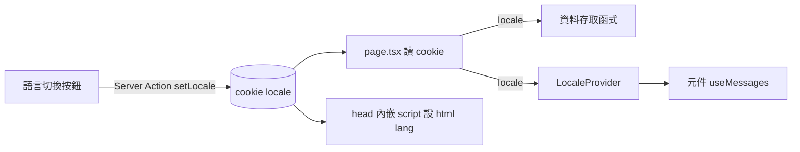

# PLAN-009：雙語介面與語言切換

## 目標

1. 網站可在英文與中文之間切換：介面文字、菜單與食譜內容、單位寫法都跟著換。
2. 選的語言記住，重新整理或下次打開仍是同一種語言。
3. 中文有一致的字型，不再退回系統字型。

## 非目標

- 補翻譯功能（用 LLM 補齊缺的語言）：維持 `localize()` 缺的語言退回另一種。
- 網址帶語言（`/zh/...`）與依瀏覽器 `Accept-Language` 自動選語言。
- 第三種語言。
- LLM 匯入的 prompt 與 server log 的文字（不是介面）。

## 驗收條件

**切換**

- 頁首 menu 按鈕旁有一個全域切換按鈕，只顯示目前語言（`en` 或 `zh`），點一下切成另一種。
- 選擇存在 cookie（ADR-0028）；重新整理、關掉再開都保持。沒有 cookie 時是英文。
- 切換後畫面內容（書名、品項、食譜、食材卡片）改為該語言，閱讀狀態（目前的書、紙張、份數、勾選）不重設。
- `<html lang>` 隨語言改變，首次載入不閃爍。

**介面文字**

- 所有介面文字（按鈕、標籤、placeholder、`aria-label`、對話框、toast、錯誤訊息）來自字典（ADR-0029），中英兩份。
- Server Action 與匯入 Route Handler 回傳的錯誤是訊息 key，畫面依目前語言顯示。
- 菜單主題名稱、單位寫法（tsp → 茶匙）、To taste、servings 也翻譯。
- 編輯卡打開時，編輯語言預設為目前的網站語言；卡上的 EN | ZH 照舊只決定正在編輯哪種語言。

**字型**

- 中文內文用 Noto Sans TC、標題用 Noto Serif TC，接在現有拉丁字型之後（ADR-0030）；英文外觀不變。

**共通**

- `CLAUDE.md` 的「UI 顯示文字一律英文」改為「UI 文字放字典，中英都要寫」。
- `pnpm typecheck`、`pnpm lint`、`pnpm format:check` 通過；以 `curl` 確認兩種語言的頁面輸出。

## 邊界情況

- cookie 值不是 `en` / `zh`（手改或舊值）：當成英文。
- 某欄位只有一種語言：顯示另一種（`localize()` 退回），不出錯。
- 菜單書是空的（尚未 seed）的首頁：也有切換按鈕。
- 編輯卡開著時頁首是 inert，不能切換；不處理編輯中切換。
- 中文字很長（例如錯誤訊息）：版面沿用現有換行。

## 設計摘要

- cookie 只在 `page.tsx` 的 `<Suspense>` 內讀（已經是每次請求讀資料庫）；root layout 維持靜態，`<html lang>` 由 head 的內嵌 script 讀 cookie 設定（ADR-0028）。
- Server Action 設 cookie 後 Next.js 自動重新 render 目前頁面，資料以新語言送回，client 狀態保留。
- 字典是 `src/lib/i18n/messages/` 的 TS 物件，英文版定義型別、中文版 `satisfies`；有參數的訊息寫成函式（ADR-0029）。
- 單位的各語言寫法放在 `src/features/recipe/units.ts`（ADR-0016）。

## 任務拆解

1. 語言基礎：字典、`LocaleProvider`、cookie、`setLocale`、`<html lang>`、切換按鈕、資料依語言讀取（#92）
2. 介面文字改用字典：菜單書架、紙張、食譜紙、食材卡片、編輯卡、主題名稱、單位（#93）
3. Server 端訊息改為訊息 key：Server Action、zod schema、匯入錯誤（#94）
4. 中文字型（#95）
5. 文件與規則：功能頁、glossary、architecture、CLAUDE.md、STATUS（#96）

## 完成後遷移清單

- [x] 功能頁：`docs/features/bilingual-ui.md`、`features/index.md`
- [x] ADR：ADR-0028、ADR-0029、ADR-0030；ADR-0006 補充中文字型
- [x] glossary：介面語言、字典、訊息 key
- [x] `docs/architecture.md`：語言的資料流、`src/lib/i18n/`
