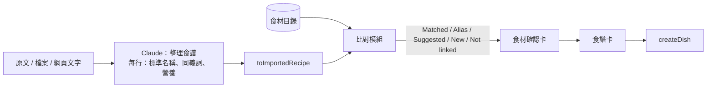

# PLAN-010：匯入的食材對應改由程式比對

## 目標

1. LLM 只整理食譜，不再收到食材目錄；每行用量給標準名稱、同義詞與營養估計（ADR-0026）。
2. 食材對應改由程式比對目錄：結果穩定、可測試，目錄變大也不受影響。
3. 食材確認卡多一個 Suggested 狀態（有多個候選時預選一個），New 列出「可能是」，讓使用者快速改連。
4. 修正實測發現的整理問題，並在開發時留下模型的原始回應，查得出缺漏步驟這類問題的原因。

## 非目標

- 不確定時再呼叫一次 LLM 判斷（ADR-0026 的替代方案）
- 語意搜尋（embedding）
- 高湯這類通用食材的對應規則（使用者擱置）
- 食材目錄的管理畫面、確認卡的目錄搜尋（#82）、讀取進度（#83）
- 食材確認卡的視覺重新設計

## 驗收條件

**LLM 輸出與 prompt**

- 請求中不再包含食材目錄。
- 每行用量回傳其中一種：
  - 食材：標準名稱（中英，照食譜用的形態，不含切法等處理方式）、中英同義詞、每 100 g 營養估計；
  - 非食材（例如煮麵用的水）。
- prompt 加入：每一步都要輸出、不提早結束；清單已有的食材不因步驟再提到而重複加一行；原文的提示或備註不當成步驟（暫時放在最後一步並標 Tip，等 #58 的筆記欄位）；器具名稱也要翻譯。保留 PLAN-007 的「A 或 B」規則與單位規則。

**程式比對**

- 比對模組是純函式，輸入一行用量（原文寫法、標準名稱、同義詞）與目錄，輸出狀態與候選。
- 正規化：大小寫、前後空白、全形半形、標點、英文複數。
- 狀態規則：

| 狀態 | 條件 |
| ---- | ---- |
| Matched | 原文寫法（整段或第一個逗號前）等於某食材的名稱或別名 |
| Alias | 原文寫法沒對上，但標準名稱或同義詞只對上一個食材 |
| Suggested | 標準名稱或同義詞對上多個食材；依相符程度排序，預選第一個 |
| New | 都沒對上；名稱用標準名稱，別名用同義詞與原文寫法，營養用 LLM 估計 |
| Not linked | LLM 標記為非食材 |

- 「可能是」：New 的行另外做寬鬆比對（英文字詞部分重疊、中文包含關係），最多列出設定檔指定的個數。
- 比對參數（候選數、寬鬆比對的門檻、忽略的字詞如 fresh）放 `src/features/recipe-import/` 的設定檔。

**食材確認卡**

- Suggested：狀態標籤與 Matched / Alias / New 可區分；下拉選單最上面一組是這一行的候選。使用者選定後依結果變成 Matched 或 Alias。
- New：列出「可能是」，點一下就改連到該食材（並預設勾選加為別名）。
- 每一行都是 Matched 時照舊跳過確認卡。
- 其餘行為（Alias 勾選、新食材欄位、Back / Cancel、名稱檢查）不變。

**除錯與穩定**

- 開發模式下，每次匯入把模型的原始回應存成檔案（資料夾加入 `.gitignore`），檔名含時間。正式模式不存。
- 轉換時不靜默丟資料：有標題但沒有內文的步驟保留標題當內文；被丟掉的行或步驟在 server log 印出警告。

**共通**

- 比對模組用假資料測試各狀態（不花錢）。
- 實測遵守 R8；用 PLAN-007 用過的文字範例與燉飯 PDF 各一次。
- `pnpm typecheck`、`pnpm lint`、`pnpm format:check` 通過。

## 邊界情況

- 目錄是空的：每行都是 New（或 Not linked），不出錯。
- 同義詞同時對上「雞腿」與「去骨雞腿肉」：Suggested，依相符程度排序。
- 原文寫法與目錄別名完全相同、但 LLM 的標準名稱指向別的食材：以原文寫法為準（Matched）。
- 兩行指向同一個新食材（標準名稱相同）：合併成一個新食材，同 PLAN-007。
- 中文單字（例如「蔥」）的寬鬆比對：包含關係至少要兩個字，避免「蔥」配到所有含蔥的食材；單字只做完全相同的比對。
- LLM 沒給同義詞：只用原文寫法與標準名稱比對。

## 設計摘要

- Route Handler 仍讀出目錄，但只交給比對模組與食材確認卡，不送給模型。
- 每行的比對結果（狀態、排序後的候選、可能是）隨匯入結果傳給前端；確認卡的列由它建立。
- 存檔流程（ADR-0025）與資料模型不變；確認卡按 Next 時照舊產生連結與目錄變更。
- 原始回應存檔放在 `src/features/recipe-import/server/`，用 `NODE_ENV` 判斷。

## 任務拆解

1. LLM 輸出格式與 prompt：拿掉目錄、每行標準名稱／同義詞／營養、prompt 修正；原始回應存檔；不靜默丟資料（#86）
2. 比對模組與設定檔，用假資料測試各狀態與邊界情況（#87）
3. 串接：Route Handler 把比對結果放進匯入結果；確認卡的列與狀態（含 Suggested、可能是）的邏輯（#88）
4. 食材確認卡 UI：Suggested 標籤、候選排在下拉選單最上面、New 的「可能是」（#89）
5. 實測（R8）與文件：`recipe-import.md`、glossary、STATUS（#90）

## 完成後遷移清單

- [x] 功能頁：`docs/features/recipe-import.md` 的流程、狀態表、參數
- [x] ADR：ADR-0026；ADR-0027（高湯）；ADR-0022 補充關閉思考
- [x] glossary：食材比對、食材確認卡的狀態
- [x] `docs/architecture.md`：匯入資料流（目錄不再送給 LLM）
