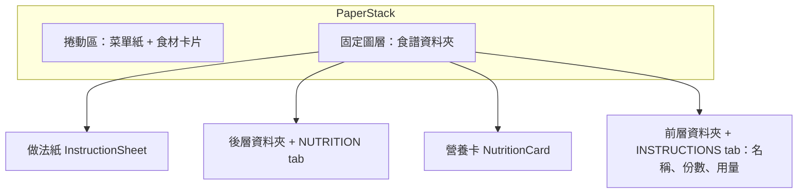

# PLAN-011：食譜資料夾

## 目標

1. 食譜紙改成資料夾：前層資料夾放食譜名稱、份數與用量，後層資料夾較深；做法紙（instruction）與營養卡從資料夾裡抽出，點 tab 開關，可同時打開。
2. 做法紙露出的高度跟隨內容、有上限；內容超過上限時，滾動把紙繼續往上抽，後面的菜單不動；換回菜單時收回。
3. 步驟一律有重點，可有料理時間；原文的提醒改存食譜筆記，在做法紙上獨立顯示。
4. 營養改成夾在做法紙上的營養卡，以圓環圖呈現。

## 非目標

- 編輯步驟時間與筆記（#58）。
- 窄螢幕版面（#10）。
- 步驟中的食材顯示用量（#54）、食譜紙用量更醒目（#55）。
- 營養卡跟著份數換算（維持每份或整份）。
- `prisma/seed-data.json` 的範例資料不補重點與時間（它只在資料庫缺資料時補範例）。

## 驗收條件

**資料夾與紙張**

- 前層資料夾：底色 `primary`、文字 `primary-foreground`，材質與菜單紙相同（`fiber-paper.webp`），透明度沿用主題的 `primary`。
- 後層資料夾：`primary` 的深色版，由主題推算，主題可覆寫（ADR-0035）。
- 做法紙 `#D9C9B7`、材質沿用舊食譜紙（`paper.webp`）；營養卡 `#B39B8C`、材質與菜單紙相同；兩者每個主題都一樣。
- 做法紙、營養卡、食材卡、編輯卡的文字統一為同一個 token（`#2e2a24`）。
- 做法紙右側打孔比舊食譜紙小、間距較大，有自己的 token。
- 營養卡用黑白迴紋針夾住；舊的彩色迴紋針改名，兩張圖尺寸與迴紋針在圖中的位置一致。

**資料夾的開關**

- 前層資料夾有 INSTRUCTIONS tab，後層有 NUTRITION tab；點 tab 切換該張紙的展開與收起，兩張各自獨立。
- 預設做法紙展開、營養卡收起；展開的 tab 文字是粗斜體。
- 展開與收起有滑入滑出動畫；減少動態效果時直接切換。
- 開關狀態跟份數、勾選一樣以食譜為單位記在書架層（`RecipeProgress`）。

**做法紙的抽出**

- 資料夾固定在畫面底部，高度統一。
- 做法紙露出的高度 = min(內容高度, 上限)；上限是資料夾上緣到頁首下方（菜單紙上緣再往下 `--paper-offset-y`）的距離。
- 食譜在上層、做法紙展開，而且內容超過上限時：滾輪、觸控拖曳、方向鍵、PageUp/PageDown/空白鍵、Home/End 把紙往上抽（上方的內容移出畫面頂端），最多抽到內容全部露出；資料夾與菜單紙不動。
- 換回菜單、收起做法紙時，抽出量歸零。
- 菜單在上層時照舊捲動菜單紙；食譜在上層時菜單紙不捲動。

**資料夾內容**

- 食譜名稱（襯線粗體、不轉大寫）、右上角編輯按鈕、`INGREDIENTS` 列（份數控制在右側、下方虛線）。
- 用量群組小標以 `[ MAIN ]` 形式顯示；用量的勾選、食材卡片、份數換算照舊。
- 版面依序嘗試：兩欄 → 三欄 → 分頁（三欄一頁，群組不拆開），資料夾高度不變；只有一頁時不顯示翻頁。

**做法紙內容**

- `INSTRUCTIONS` 標題列，下方實線。
- 步驟群組小標 `[ LABEL ]`；每步一行粗體重點加句點，下一行縮排顯示內文；有時間的步驟在重點那行右側顯示計時圖示與時間（例如 `5m`、`1h 30m`）。
- 有筆記時在最後顯示 `[ NOTES ]` 與編號清單。

**營養卡**

- 圓環圖分蛋白質、碳水、脂肪三段，長度依熱量佔比（4 / 4 / 9 kcal/g）；中間是卡路里；下方三行標克數。
- 標示每份或整份；不完整時加 `*` 與說明。沒有營養資料時顯示一句說明。

**匯入**

- LLM 每一步都給重點；給 `minutes`：只在文字明確寫出時長時填，範圍取上限、多段加總、頻率（每 3-5 分鐘攪拌）不算，其餘為 null。
- 原文的提醒寫進食譜筆記，不再做成最後一步的 Tip。
- 步驟時間與筆記經過食譜編輯卡存檔後保留；編輯既有食譜不會清掉時間與筆記。

**既有資料**

- 先 `pnpm db:backup`（R10）；所有步驟補上重點，文字寫明時長的步驟補上時間，現有的 Tip 步驟移到筆記。

**共通**

- `pnpm typecheck`、`pnpm lint`、`pnpm format:check` 通過；改 `globals.css` 後依 R2 確認 dev server 的 CSS。
- 用無頭瀏覽器檢查：預設、全部收起、全部展開、抽出、換回菜單後收回、分頁（R4）。
- 匯入實測一次，遵守 R8。

## 邊界情況

- 做法紙內容比上限短：露出內容高度，不能抽。
- 視窗很矮、上限小於最小值：上限取最小值（`--instruction-min-reveal`），紙的上緣可能蓋到頁首。
- 沒有任何步驟：做法紙只有標題列。
- 沒有選品項（菜單空的）：資料夾不顯示內容，點它沒反應（同舊行為）。
- 營養卡打開、做法紙收起：營養卡照樣露出。
- 群組本身比一欄還高：只能在群組中間拆欄，照樣分頁。
- 份數或語言改變導致欄數改變：重新計算，頁碼超出時回到最後一頁。
- 書架兩側與總覽中的書：資料夾與紙張照目前狀態顯示，點了打開該書，不能抽紙。
- LLM 回傳 0 或負數分鐘：當作沒有時間。

## 設計摘要

- `PaperStack` 的 offset 不再放進捲動區，改成填滿書本的固定圖層（ADR-0033）；換紙動畫照舊，只是固定圖層不隨捲動位置計算。
- 由後往前：做法紙 → 後層資料夾 → 營養卡 → 前層資料夾。資料夾以下緣對齊畫面底部；紙與營養卡以資料夾上緣為基準，用 transform 往上移出，資料夾下緣以下裁掉。
- 抽出量是 motion value，由 `useSheetPull` 處理滾輪、觸控與鍵盤（ADR-0033）；不用巢狀捲動區，避免滾輪不知道在捲哪個。
- 用量欄位以 CSS multi-column 排版；量測是否溢出決定欄數與頁數，分頁就是左右平移整個多欄容器。
- 可調參數：版面與顏色在 `globals.css`，動畫與抽出的手感在 `src/features/recipe/folder-motion.ts`。
- 時間與重點交給 LLM、提醒存 `Recipe.notes`（ADR-0034）；資料庫 schema 不變。
- 後層資料夾的顏色在 `[data-menu-theme]` 區塊以 `oklch(from …)` 推算（ADR-0035）。

## 任務拆解

1. 材質、顏色與迴紋針：共用文字色 token、後層資料夾推算色與主題覆寫、做法紙與營養卡的顏色與材質、打孔 token、迴紋針圖檔（#115）
2. 固定圖層與資料夾：`PaperStack` 改版、資料夾外觀、tab 開關與動畫、開關狀態存進 `RecipeProgress`（#116）
3. 做法紙的抽出：`useSheetPull`、上限計算、滾輪／觸控／鍵盤、換回菜單時收回（#117）
4. 資料夾內容：名稱、份數、用量群組，兩欄 → 三欄 → 分頁（#118）
5. 做法紙內容：步驟重點、時間、筆記（#119）
6. 營養卡與圓環圖（#120）
7. 匯入：prompt、LLM 輸出格式、草稿與存檔保留時間與筆記；實測（R8）（#121）
8. 既有資料：備份後補重點、時間，Tip 移到筆記（#122）
9. 文件：功能頁、ADR、glossary、STATUS（#123）

## 完成後遷移清單

- [x] 功能頁：新增 `docs/features/recipe-folder.md`；更新 `paper-stack.md`、`dish-totals.md`、`recipe-import.md`、`menu-shelf.md`、`editor.md`、`ingredient-card.md`、`features/index.md`
- [x] ADR：ADR-0033（食譜資料夾與抽出）、ADR-0034（步驟時間與重點由 LLM 產生）、ADR-0035（後層資料夾顏色由主題推算）；ADR-0007 標註部分取代
- [x] glossary：食譜資料夾、做法紙、營養卡、步驟時間、食譜筆記
- [x] `docs/architecture.md`：首頁版面
